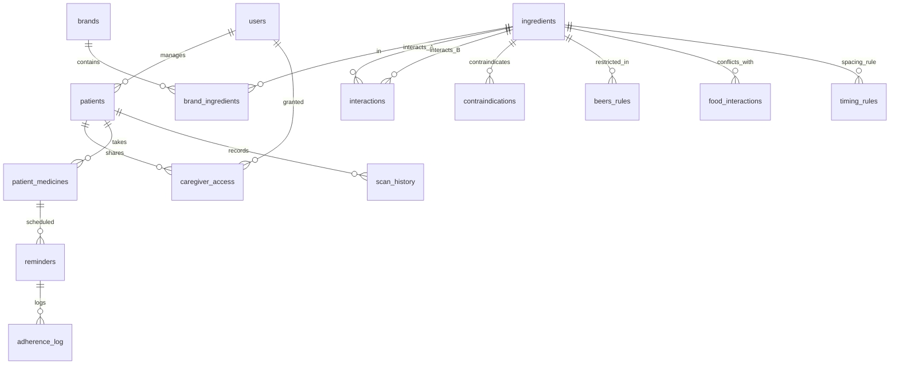
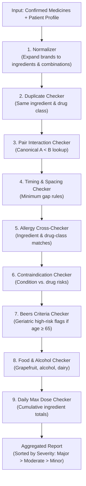
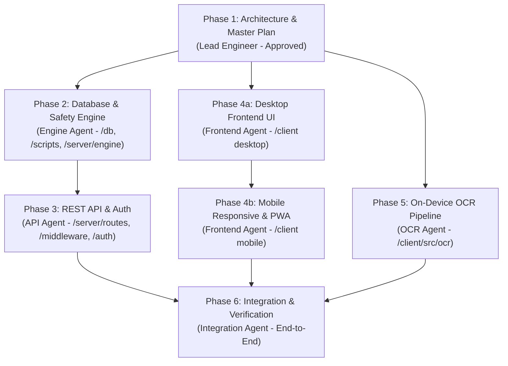

# MedGuard: Master Engineering Implementation Plan

> [!IMPORTANT]
> **Core Safety Directive:** MedGuard is a medical polypharmacy screening tool. All drug interaction, duplicate, timing, allergy, contraindication, and dose checks are **100% deterministic** (driven strictly by curated database rules, never by AI or LLM guesses). We **never use the word "safe"**—when no issues are found, the system explicitly reports: *"No known interaction found in our data."*

---

## 1. Plain-Language Glossary for Agentic Engineering

Because you are new to agentic engineering, here is a simple translation of key technical concepts used throughout this plan:

| Term | Simple Definition | Why It Matters for MedGuard |
|---|---|---|
| **Agentic Engineering** | Building software using specialized AI agents, where each agent has strict boundaries, owns specific folders, and follows strict rules. | Prevents AI agents from overwriting each other's code or making unauthorized changes to critical safety logic. |
| **Deterministic Engine** | Code that always produces the exact same answer given the same input, using fixed rules and verified database tables. | We never let an AI "hallucinate" or guess whether two drugs interact. Lives depend on deterministic correctness. |
| **Active Ingredient vs. Brand** | A **brand** is the commercial name (e.g., *Crocin* or *Dolo 650*), while the **active ingredient** is the chemical that does the work (both are *Paracetamol*). | Patients frequently take two different brands containing the exact same chemical, risking accidental toxic overdose. |
| **Normalization** | The process of taking messy text or brand names (e.g., *"Pan-D tablet"*) and mapping them to their verified ingredients (*Pantoprazole 40mg + Domperidone 30mg*). | Allows the safety engine to evaluate interactions based on standard international chemical identifiers. |
| **RxNorm / RxCUI** | A standardized catalog of clinical drugs created by the US National Library of Medicine. Each ingredient has an ID called an RxCUI. | Provides a universal language to link Indian brands to global interaction databases like DDInter. |
| **Beers Criteria** | A clinical guideline published by the American Geriatrics Society listing medications that are potentially inappropriate for adults aged 65 and older. | Elderly bodies process medicines differently; certain sleeping pills, allergy medicines, or pain relievers can cause falls, confusion, or urinary retention. |
| **SQL Schema & Migration** | The blueprint of the database tables (Schema) and safe, incremental step-by-step update scripts (Migrations). | Keeps database changes versioned, reversible, and consistent across development and production. |
| **Row-Level Security (RLS)** | A database security rule ensuring a user can only read or modify rows that belong to them. | Prevents one caregiver from accidentally or maliciously viewing another caregiver's patient health data. |
| **JWT (JSON Web Token)** | A secure, encrypted digital badge issued upon login that the browser sends with every request to prove identity. | Ensures that only authenticated caregivers can access their loved ones' records. |
| **Web Worker** | A background script running inside the user's web browser that executes heavy tasks without freezing the visual interface. | OCR strip scanning is computationally heavy; running it in a Web Worker keeps the app responsive and smooth. |
| **PWA (Progressive Web App)** | A website built with modern web technologies that can be installed on an Android or iOS home screen like a native mobile app and works offline. | Caregivers can install MedGuard directly from the browser without needing an app store. |

---

## 2. Final Folder Structure & Ownership

Strict folder ownership guarantees that no agent touches files outside its designated domain, adhering to `AGENTS.md` Section 3.

```
MedGuard/
├── AGENTS.md                                # Human only: master project rules
├── PRD.md                                  # Human only: product requirements document
├── README.md                               # Human only: project overview & roadmap
│
├── db/                                     # Owner: Engine Agent
│   ├── migrations/                         # Sequential SQL migration files
│   │   ├── 001_initial_schema.sql          # Users, patients, access, audit
│   │   ├── 002_drug_catalog.sql            # Ingredients, brands, brand_ingredients
│   │   ├── 003_safety_rules.sql            # Interactions, contraindications, beers, food, timing
│   │   ├── 004_patient_records.sql         # Patient medicines, scan history, reminders, adherence
│   │   └── 005_indexes_and_rls.sql         # Performance indexes, trigram search, RLS policies
│   ├── seeds/                              # Curated seed datasets for local testing
│   │   ├── indian_brands_seed.json         # Top Indian brands mapped to ingredients
│   │   ├── ingredients_seed.json           # Active ingredients with drug classes and max doses
│   │   ├── interactions_seed.json          # Known drug-drug interactions (DDInter format)
│   │   └── safety_rules_seed.json          # Beers criteria, timing, contraindications, food
│   └── dbClient.js                         # PostgreSQL / Supabase connection pool setup
│
├── scripts/                                # Owner: Engine Agent
│   ├── migrate.js                          # Node.js runner to apply SQL migrations in sequence
│   ├── seed.js                             # Seed database with sample/curated datasets
│   ├── import-ddinter.js                   # Ingest and deduplicate DDInter interaction data
│   ├── import-indian-brands.js             # Ingest local Indian brand catalog
│   └── verify-db.js                        # Health check verifying tables, indexes, and counts
│
├── server/                                 # Backend application
│   ├── server.js                           # Server entrypoint (starts Express app)
│   ├── app.js                              # Express app configuration & middleware pipeline
│   ├── config.js                           # Environment variable validation (.env loading)
│   ├── .env.example                        # Template of required configuration keys
│   │
│   ├── auth/                               # Owner: API Agent
│   │   ├── authService.js                  # Password hashing (bcrypt) & token signing
│   │   └── tokenService.js                 # Refresh token lifecycle & rotation
│   │
│   ├── middleware/                         # Owner: API Agent
│   │   ├── authenticate.js                 # JWT verification (attaches req.user)
│   │   ├── validate.js                     # Request schema validator (Zod or lightweight schema)
│   │   ├── rateLimiter.js                  # IP & user rate limiting (for auth and check routes)
│   │   └── errorHandler.js                 # Centralized error handler (NEVER leaks health data)
│   │
│   ├── routes/                             # Owner: API Agent
│   │   ├── authRoutes.js                   # /api/auth (register, login, refresh, logout)
│   │   ├── patientRoutes.js                # /api/patients & /api/patients/:id/medicines
│   │   ├── medicineRoutes.js               # /api/medicines/search & /api/medicines/normalize
│   │   ├── checkRoutes.js                  # /api/check (core safety analysis endpoint)
│   │   ├── reminderRoutes.js               # /api/reminders & adherence logging
│   │   └── reportRoutes.js                 # /api/patients/:id/report.pdf (PDF generation)
│   │
│   └── engine/                             # Owner: Engine Agent
│       ├── index.js                        # Orchestrator: runAllChecks(patient, medicines)
│       ├── normalizer.js                   # Brand-to-ingredient & combination expander
│       ├── duplicateChecker.js             # Same ingredient & same drug-class detector
│       ├── interactionChecker.js           # Pairwise drug-drug interaction checker (A < B)
│       ├── timingChecker.js                # Spacing rules (e.g., antacids vs antibiotics)
│       ├── allergyChecker.js               # Ingredient and drug-class allergy cross-check
│       ├── contraindicationChecker.js      # Patient disease/condition vs drug contraindications
│       ├── beersChecker.js                 # Beers Criteria validator for age >= 65
│       ├── foodChecker.js                  # Food & alcohol interaction rules
│       ├── doseChecker.js                  # Daily cumulative maximum dose validator
│       ├── constants.js                    # Severity definitions, standard disclaimer text
│       └── tests/                          # Safety engine unit & golden tests
│           ├── golden-pairs.json           # 32 verified dangerous drug pairs
│           ├── normalizer.test.js
│           ├── duplicateChecker.test.js
│           ├── interactionChecker.test.js
│           ├── timingChecker.test.js
│           ├── allergyChecker.test.js
│           ├── contraindicationChecker.test.js
│           ├── beersChecker.test.js
│           ├── foodChecker.test.js
│           ├── doseChecker.test.js
│           └── engine.test.js              # Full pipeline golden suite
│
├── client/                                 # Frontend application (React + Vite + Tailwind)
│   ├── index.html                          # HTML shell with viewport, Noto Sans, PWA meta
│   ├── vite.config.js                      # Vite bundler configuration
│   ├── tailwind.config.js                  # Exact tokens from Serene Clinical Assurance design
│   ├── postcss.config.js
│   ├── package.json
│   ├── public/                             # PWA assets
│   │   ├── manifest.webmanifest            # Installable web app manifest
│   │   ├── favicon.ico
│   │   └── icons/                          # PWA icons (192x192, 512x512)
│   │
│   └── src/                                # Owner: Frontend Agent (except src/ocr)
│       ├── main.jsx                        # React root mounting
│       ├── App.jsx                         # Router configuration and global providers
│       ├── index.css                       # Design tokens, typography base, accessibility resets
│       │
│       ├── api/                            # Centralized API client layer
│       │   ├── client.js                   # Fetch/Axios instance with auth interceptors
│       │   ├── authApi.js                  # Auth endpoint calls
│       │   ├── patientApi.js               # Patient CRUD & medicine list calls
│       │   ├── medicineApi.js              # Search and normalization calls
│       │   └── checkApi.js                 # Safety check calls (swappable to mocks)
│       │
│       ├── mocks/                          # Mocked backend data for isolated UI dev
│       │   ├── mockPatients.js
│       │   ├── mockMedicines.js
│       │   └── mockReport.js
│       │
│       ├── context/                        # Global state management
│       │   ├── AuthContext.jsx             # Caregiver session state
│       │   ├── PatientContext.jsx          # Selected active patient
│       │   ├── LanguageContext.jsx         # English / Hindi / Regional switch
│       │   └── TextSizeContext.jsx         # Large-text mode scaling
│       │
│       ├── i18n/                           # Multilingual translations
│       │   ├── en.json                     # English strings (source of truth)
│       │   ├── hi.json                     # Hindi strings stub
│       │   └── index.js                    # Translation hook
│       │
│       ├── components/                     # Reusable design system components
│       │   ├── common/
│       │   │   ├── Button.jsx              # 52px touch-friendly primary/secondary button
│       │   │   ├── Card.jsx                # Tier 1 rounded card container with 1.5px border
│       │   │   ├── Chip.jsx                # Dismissible condition/allergy tag
│       │   │   ├── Input.jsx               # 56px input with 18px text and clear button
│       │   │   ├── SeverityBadge.jsx       # Icon + Label + Fill (never color alone)
│       │   │   ├── FindingCard.jsx         # Structured finding with what-to-do guidance
│       │   │   ├── DoseLimitBar.jsx        # Visual progress bar for max daily dose
│       │   │   ├── PrivacyPromiseBanner.jsx# "Your photos stay on this phone" banner
│       │   │   ├── DisclaimerFooter.jsx    # Mandatory screening tool disclaimer
│       │   │   ├── EmptyState.jsx
│       │   │   └── LoadingState.jsx
│       │   │
│       │   └── layout/
│       │       ├── AppShell.jsx            # Responsive wrapper (desktop sidebar / mobile bottom)
│       │       ├── Sidebar.jsx             # Desktop left navigation (1280px+)
│       │       ├── TopBar.jsx              # Header with language/text toggle & user menu
│       │       └── BottomNav.jsx           # Mobile 4-tab bottom navigation (Home/Scan/Schedule/Settings)
│       │
│       ├── pages/                          # Application screens (match Stitch export)
│       │   ├── WelcomeLoginPage.jsx        # 1. Welcome / Login / Register
│       │   ├── HomeDashboardPage.jsx       # 2. Home dashboard
│       │   ├── PatientDetailPage.jsx       # 3. Patient detail view
│       │   ├── ScanPage.jsx                # 4. Medicine strip scanner (camera / upload)
│       │   ├── ConfirmMedicinesPage.jsx    # 5. Confirm & edit detected medicines
│       │   ├── SafetyReportPage.jsx        # 6. Safety report (with print stylesheet)
│       │   ├── PatientProfileFormPage.jsx  # 7. Add/edit patient profile
│       │   ├── SchedulePage.jsx            # 8. Daily schedule & reminders
│       │   ├── EmergencyCardPage.jsx       # 9. Emergency medical card
│       │   └── SettingsPage.jsx            # 10. Caregiver settings & data deletion
│       │
│       └── ocr/                            # Owner: OCR Agent ONLY
│           ├── index.js                    # Exported public scanStrip(imageFile) hook
│           ├── imagePreprocessor.js        # Canvas: resize, grayscale, contrast, threshold, deskew
│           ├── ocrWorker.js                # Tesseract.js running in dedicated Web Worker
│           ├── candidateExtractor.js       # Heuristic parser removing batch/price/dates
│           ├── fuzzyMatcher.js             # Fuse.js brand/ingredient matcher with confidence
│           └── tests/                      # Local evaluation script for /test-assets
│               └── evaluate-ocr.js
│
├── test-assets/                            # Sample blister strip photos for OCR testing
└── docs/                                   # Documentation and approved UI design
```

---

## 3. SQL Schema & Migration Plan

The database runs on PostgreSQL (hosted on Supabase or local PostgreSQL). All patient records are protected by Row-Level Security (RLS) scoped strictly to the authenticated caregiver.



### Table Definitions

#### `001_initial_schema.sql`
```sql
CREATE EXTENSION IF NOT EXISTS "uuid-ossp";
CREATE EXTENSION IF NOT EXISTS "pg_trgm";

-- Caregiver accounts
CREATE TABLE users (
    id UUID PRIMARY KEY DEFAULT uuid_generate_v4(),
    name VARCHAR(255) NOT NULL,
    email VARCHAR(255) UNIQUE NOT NULL,
    password_hash VARCHAR(255) NOT NULL,
    language VARCHAR(10) DEFAULT 'en',
    created_at TIMESTAMPTZ DEFAULT NOW(),
    updated_at TIMESTAMPTZ DEFAULT NOW()
);

-- Patient profiles
CREATE TABLE patients (
    id UUID PRIMARY KEY DEFAULT uuid_generate_v4(),
    caregiver_id UUID NOT NULL REFERENCES users(id) ON DELETE CASCADE,
    name VARCHAR(255) NOT NULL,
    dob DATE NOT NULL,
    weight_kg NUMERIC(5,2),
    allergies JSONB DEFAULT '[]'::jsonb,      -- Array of strings: ["penicillin", "aspirin"]
    conditions JSONB DEFAULT '[]'::jsonb,     -- Array of strings: ["hypertension", "ckd"]
    created_at TIMESTAMPTZ DEFAULT NOW(),
    updated_at TIMESTAMPTZ DEFAULT NOW()
);

-- Multi-caregiver sharing & access control
CREATE TABLE caregiver_access (
    id UUID PRIMARY KEY DEFAULT uuid_generate_v4(),
    patient_id UUID NOT NULL REFERENCES patients(id) ON DELETE CASCADE,
    user_id UUID NOT NULL REFERENCES users(id) ON DELETE CASCADE,
    role VARCHAR(50) DEFAULT 'viewer',        -- 'owner', 'editor', 'viewer'
    expires_at TIMESTAMPTZ,
    UNIQUE(patient_id, user_id)
);

-- Audit log (NEVER logs medicine names or patient names)
CREATE TABLE audit_log (
    id UUID PRIMARY KEY DEFAULT uuid_generate_v4(),
    user_id UUID REFERENCES users(id) ON DELETE SET NULL,
    action VARCHAR(100) NOT NULL,
    created_at TIMESTAMPTZ DEFAULT NOW()
);
```

#### `002_drug_catalog.sql`
```sql
-- Standardized active ingredients
CREATE TABLE ingredients (
    id SERIAL PRIMARY KEY,
    name VARCHAR(255) UNIQUE NOT NULL,       -- Normalized lowercase: 'paracetamol'
    rxcui VARCHAR(50),                       -- RxNorm Identifier (e.g., '161')
    drug_class VARCHAR(255),                 -- 'NSAID', 'ACE Inhibitor', 'SSRI'
    max_daily_dose_mg NUMERIC(10,2)          -- e.g., 4000 for paracetamol
);

-- Commercial brands (focused on Indian market)
CREATE TABLE brands (
    id SERIAL PRIMARY KEY,
    brand_name VARCHAR(255) NOT NULL,        -- 'Dolo 650', 'Pan-D'
    manufacturer VARCHAR(255),               -- 'Micro Labs', 'Alkem'
    form VARCHAR(100),                       -- 'tablet', 'capsule', 'syrup'
    strength_raw VARCHAR(100)                -- '650mg', '40mg/30mg'
);

-- Multi-ingredient mapping (Combination product resolver)
CREATE TABLE brand_ingredients (
    id SERIAL PRIMARY KEY,
    brand_id INT NOT NULL REFERENCES brands(id) ON DELETE CASCADE,
    ingredient_id INT NOT NULL REFERENCES ingredients(id) ON DELETE CASCADE,
    strength_mg NUMERIC(10,2) NOT NULL,
    UNIQUE(brand_id, ingredient_id)
);
```

#### `003_safety_rules.sql`
```sql
-- Pairwise drug-drug interactions (DDInter / TWOSIDES)
-- CRITICAL SAFETY RULE: Stored with canonical ordering (ingredient_a < ingredient_b)
CREATE TABLE interactions (
    id SERIAL PRIMARY KEY,
    ingredient_a VARCHAR(255) NOT NULL,
    ingredient_b VARCHAR(255) NOT NULL,
    severity VARCHAR(20) NOT NULL,           -- 'major', 'moderate', 'minor'
    summary VARCHAR(500) NOT NULL,
    explanation TEXT NOT NULL,
    action TEXT NOT NULL,                    -- Clear next step for caregiver
    source VARCHAR(100) NOT NULL,            -- e.g., 'DDInter v2.0'
    CONSTRAINT chk_canonical_order CHECK (ingredient_a < ingredient_b),
    UNIQUE(ingredient_a, ingredient_b)
);

-- Timing & spacing conflicts
CREATE TABLE timing_rules (
    id SERIAL PRIMARY KEY,
    ingredient_a VARCHAR(255) NOT NULL,
    ingredient_b VARCHAR(255) NOT NULL,
    min_gap_hours NUMERIC(4,1) NOT NULL,     -- e.g., 2.0 or 4.0 hours
    severity VARCHAR(20) DEFAULT 'moderate',
    advice TEXT NOT NULL,                    -- "Take at least 2 hours apart"
    source VARCHAR(100) NOT NULL,
    CONSTRAINT chk_timing_order CHECK (ingredient_a < ingredient_b),
    UNIQUE(ingredient_a, ingredient_b)
);

-- Disease-drug contraindications
CREATE TABLE contraindications (
    id SERIAL PRIMARY KEY,
    ingredient_id INT NOT NULL REFERENCES ingredients(id) ON DELETE CASCADE,
    condition VARCHAR(255) NOT NULL,         -- 'ckd', 'heart_failure', 'asthma'
    severity VARCHAR(20) NOT NULL,           -- 'major', 'moderate'
    description TEXT NOT NULL,
    action TEXT NOT NULL,
    source VARCHAR(100) NOT NULL
);

-- Beers Criteria for elderly patients (age 65+)
CREATE TABLE beers_rules (
    id SERIAL PRIMARY KEY,
    ingredient_id INT NOT NULL REFERENCES ingredients(id) ON DELETE CASCADE,
    rationale TEXT NOT NULL,
    recommendation TEXT NOT NULL,
    severity VARCHAR(20) DEFAULT 'major',
    source VARCHAR(100) DEFAULT 'AGS Beers Criteria 2023'
);

-- Food and alcohol interactions
CREATE TABLE food_interactions (
    id SERIAL PRIMARY KEY,
    ingredient_id INT NOT NULL REFERENCES ingredients(id) ON DELETE CASCADE,
    item VARCHAR(100) NOT NULL,              -- 'alcohol', 'grapefruit', 'dairy'
    severity VARCHAR(20) NOT NULL,           -- 'major', 'moderate', 'minor'
    description TEXT NOT NULL,
    action TEXT NOT NULL,
    source VARCHAR(100) NOT NULL
);
```

#### `004_patient_records.sql`
```sql
-- Active medicines recorded for a patient
CREATE TABLE patient_medicines (
    id UUID PRIMARY KEY DEFAULT uuid_generate_v4(),
    patient_id UUID NOT NULL REFERENCES patients(id) ON DELETE CASCADE,
    brand_id INT REFERENCES brands(id) ON DELETE SET NULL,
    custom_name VARCHAR(255),                -- Used when brand is entered manually
    dose VARCHAR(100),                       -- e.g., '1 tablet'
    frequency VARCHAR(100),                  -- 'twice daily', 'with breakfast'
    timing_schedule JSONB DEFAULT '[]'::jsonb, -- e.g., ["08:00", "20:00"]
    start_date DATE,
    end_date DATE,
    active BOOLEAN DEFAULT TRUE,
    created_at TIMESTAMPTZ DEFAULT NOW()
);

-- Scan history log (NEVER stores photos - privacy guarantee)
CREATE TABLE scan_history (
    id UUID PRIMARY KEY DEFAULT uuid_generate_v4(),
    patient_id UUID NOT NULL REFERENCES patients(id) ON DELETE CASCADE,
    matched_drugs JSONB NOT NULL,            -- Detected medicines and match status
    confidence NUMERIC(4,2),                 -- Average confidence (0.0 to 1.0)
    created_at TIMESTAMPTZ DEFAULT NOW()
);

-- Schedule reminders and adherence
CREATE TABLE reminders (
    id UUID PRIMARY KEY DEFAULT uuid_generate_v4(),
    patient_medicine_id UUID NOT NULL REFERENCES patient_medicines(id) ON DELETE CASCADE,
    reminder_time TIME NOT NULL,
    status VARCHAR(20) DEFAULT 'active'      -- 'active', 'paused'
);

CREATE TABLE adherence_log (
    id UUID PRIMARY KEY DEFAULT uuid_generate_v4(),
    reminder_id UUID NOT NULL REFERENCES reminders(id) ON DELETE CASCADE,
    status VARCHAR(20) NOT NULL,             -- 'taken', 'missed', 'skipped'
    logged_at TIMESTAMPTZ DEFAULT NOW()
);
```

#### `005_indexes_and_rls.sql`
```sql
-- Indexes for rapid lookups and fuzzy autocomplete
CREATE INDEX idx_brands_name_trgm ON brands USING gin (lower(brand_name) gin_trgm_ops);
CREATE INDEX idx_ingredients_name ON ingredients (lower(name));
CREATE INDEX idx_interactions_lookup ON interactions (ingredient_a, ingredient_b);
CREATE INDEX idx_timing_lookup ON timing_rules (ingredient_a, ingredient_b);
CREATE INDEX idx_patient_medicines_active ON patient_medicines (patient_id) WHERE active = TRUE;

-- Row Level Security (RLS)
ALTER TABLE patients ENABLE ROW LEVEL SECURITY;
ALTER TABLE patient_medicines ENABLE ROW LEVEL SECURITY;
ALTER TABLE scan_history ENABLE ROW LEVEL SECURITY;
ALTER TABLE reminders ENABLE ROW LEVEL SECURITY;
ALTER TABLE adherence_log ENABLE ROW LEVEL SECURITY;

-- Caregiver isolation policy
CREATE POLICY caregiver_patients_policy ON patients
    FOR ALL
    USING (caregiver_id = auth.uid() OR id IN (
        SELECT patient_id FROM caregiver_access WHERE user_id = auth.uid()
    ));

CREATE POLICY caregiver_medicines_policy ON patient_medicines
    FOR ALL
    USING (patient_id IN (
        SELECT id FROM patients WHERE caregiver_id = auth.uid()
    ));
```

---

## 4. REST API Contract

All endpoints run on Express, require `Content-Type: application/json`, and return consistent envelope responses. Endpoints marked 🔒 require `Authorization: Bearer <accessToken>`.

### Error Response Schema
```json
{
  "success": false,
  "error": {
    "code": "VALIDATION_ERROR | UNAUTHORIZED | NOT_FOUND | RATE_LIMITED | INTERNAL_ERROR",
    "message": "Human-friendly explanation of the issue."
  }
}
```

---

### Auth Endpoints

#### 1. `POST /api/auth/register`
Creates a caregiver account.
* **Request Body:**
```json
{
  "name": "Priya Sharma",
  "email": "priya.sharma@example.com",
  "password": "StrongPassword123!",
  "language": "en"
}
```
* **Success Response (201 Created):**
```json
{
  "success": true,
  "data": {
    "user": {
      "id": "c7a8b41e-3f62-4299-9b9c-29b67484dfb1",
      "name": "Priya Sharma",
      "email": "priya.sharma@example.com",
      "language": "en"
    },
    "tokens": {
      "accessToken": "eyJhbGciOi...",
      "refreshToken": "d82f48ab..."
    }
  }
}
```

#### 2. `POST /api/auth/login`
Rate limited: 5 attempts per 15 minutes per IP.
* **Request Body:**
```json
{
  "email": "priya.sharma@example.com",
  "password": "StrongPassword123!"
}
```
* **Success Response (200 OK):**
```json
{
  "success": true,
  "data": {
    "user": {
      "id": "c7a8b41e-3f62-4299-9b9c-29b67484dfb1",
      "name": "Priya Sharma",
      "email": "priya.sharma@example.com",
      "language": "en"
    },
    "tokens": {
      "accessToken": "eyJhbGciOi...",
      "refreshToken": "d82f48ab..."
    }
  }
}
```

#### 3. `POST /api/auth/refresh`
Rotates the refresh token and returns a new access token.
* **Request Body:**
```json
{
  "refreshToken": "d82f48ab..."
}
```
* **Success Response (200 OK):**
```json
{
  "success": true,
  "data": {
    "accessToken": "eyJhbGciOi...",
    "refreshToken": "new_refresh_token_string"
  }
}
```

#### 4. `POST /api/auth/logout` 🔒
Invalidates the current refresh token.
* **Request Body:** `{ "refreshToken": "..." }`
* **Success Response (200 OK):** `{ "success": true, "message": "Logged out successfully" }`

---

### Medicine Catalog Endpoints

#### 5. `GET /api/medicines/search?q={query}` 🔒
Autocomplete search for brands and generic ingredients.
* **Query Params:** `q` (minimum 2 chars, e.g., `dolo` or `crocin`)
* **Success Response (200 OK):**
```json
{
  "success": true,
  "data": [
    {
      "id": 104,
      "type": "brand",
      "name": "Dolo 650",
      "manufacturer": "Micro Labs",
      "form": "tablet",
      "strength": "650mg",
      "ingredients": [
        { "name": "paracetamol", "strengthMg": 650 }
      ]
    },
    {
      "id": 218,
      "type": "brand",
      "name": "Pan-D",
      "manufacturer": "Alkem",
      "form": "capsule",
      "strength": "40mg/30mg",
      "ingredients": [
        { "name": "pantoprazole", "strengthMg": 40 },
        { "name": "domperidone", "strengthMg": 30 }
      ]
    }
  ]
}
```

#### 6. `POST /api/medicines/normalize` 🔒
Takes messy brand names or OCR strings and maps them to normalized ingredients.
* **Request Body:**
```json
{
  "queries": ["Dolo 650", "Pan-D tablet", "UnknownStripX 10mg"]
}
```
* **Success Response (200 OK):**
```json
{
  "success": true,
  "data": {
    "resolved": [
      {
        "query": "Dolo 650",
        "brandId": 104,
        "brandName": "Dolo 650",
        "ingredients": [
          { "name": "paracetamol", "rxcui": "161", "drugClass": "Analgesic", "strengthMg": 650 }
        ]
      },
      {
        "query": "Pan-D tablet",
        "brandId": 218,
        "brandName": "Pan-D",
        "ingredients": [
          { "name": "pantoprazole", "rxcui": "40790", "drugClass": "PPI", "strengthMg": 40 },
          { "name": "domperidone", "rxcui": "3587", "drugClass": "Antiemetic", "strengthMg": 30 }
        ]
      }
    ],
    "unresolved": [
      {
        "query": "UnknownStripX 10mg",
        "reason": "Not found in local brand catalog or RxNorm"
      }
    ]
  }
}
```

---

### Core Safety Engine Endpoint

#### 7. `POST /api/check` 🔒
Rate limited: 30 requests per minute. Evaluates confirmed medicines against the patient's profile.
* **Request Body:**
```json
{
  "patientId": "8a32b214-41d1-42aa-91e0-bc4f285d8e20",
  "confirmedMedicines": [
    {
      "brandName": "Warfarin 5mg",
      "ingredients": [{ "name": "warfarin", "strengthMg": 5 }],
      "dose": "1 tablet",
      "frequency": "once daily evening"
    },
    {
      "brandName": "Disprin",
      "ingredients": [{ "name": "aspirin", "strengthMg": 325 }],
      "dose": "1 tablet",
      "frequency": "as needed"
    },
    {
      "brandName": "Dolo 650",
      "ingredients": [{ "name": "paracetamol", "strengthMg": 650 }],
      "dose": "1 tablet",
      "frequency": "three times daily"
    },
    {
      "brandName": "Crocin 500",
      "ingredients": [{ "name": "paracetamol", "strengthMg": 500 }],
      "dose": "1 tablet",
      "frequency": "twice daily"
    }
  ],
  "unrecognized": ["HerbalChurnaPacket"]
}
```
* **Success Response (200 OK):**
```json
{
  "success": true,
  "data": {
    "summary": {
      "overallStatus": "major",
      "totalFindings": 2,
      "majorCount": 1,
      "moderateCount": 0,
      "minorCount": 0,
      "duplicateCount": 1,
      "unrecognizedCount": 1
    },
    "findings": [
      {
        "type": "interaction",
        "severity": "major",
        "items": ["warfarin", "aspirin"],
        "summary": "Combining Warfarin and Aspirin greatly increases the risk of serious bleeding.",
        "explanation": "Warfarin slows down blood clotting, and Aspirin stops platelets from sticking together. Taking both multiplies the risk of stomach ulcers and internal bleeding.",
        "action": "Contact the patient's doctor or cardiologist today before giving these together. Do not stop prescribed medicines without advice.",
        "source": "DDInter v2.0"
      },
      {
        "type": "duplicate",
        "severity": "major",
        "items": ["Dolo 650", "Crocin 500"],
        "summary": "Duplicate active ingredient: both medicines contain Paracetamol.",
        "explanation": "Dolo 650 and Crocin 500 both contain Paracetamol. Taking both leads to a total daily intake of 2950mg, increasing the risk of accidental liver damage.",
        "action": "Do not give both at the same time. Check with the doctor or pharmacist to pick one brand.",
        "source": "MedGuard Formulation Database"
      }
    ],
    "unrecognized": [
      {
        "input": "HerbalChurnaPacket",
        "reason": "Could not identify active ingredients in catalog. Please show this packaging to a pharmacist."
      }
    ],
    "disclaimer": "MedGuard is an informational screening tool. It does not provide medical advice, diagnosis or treatment, and it does not replace consultation with a doctor or pharmacist. Never start, stop or change a medicine without professional guidance."
  }
}
```

---

### Patient & Medicine Records Endpoints

#### 8. `GET /api/patients` 🔒
Returns all patient profiles managed by the caregiver.
* **Success Response (200 OK):**
```json
{
  "success": true,
  "data": [
    {
      "id": "8a32b214-41d1-42aa-91e0-bc4f285d8e20",
      "name": "Ramesh Sharma",
      "dob": "1954-04-12",
      "age": 72,
      "weightKg": 68.5,
      "allergies": ["penicillin"],
      "conditions": ["hypertension", "type 2 diabetes"],
      "activeMedicineCount": 5
    }
  ]
}
```

#### 9. `POST /api/patients` 🔒
Creates a new patient profile.
* **Request Body:**
```json
{
  "name": "Saraswathi Devi",
  "dob": "1951-08-15",
  "weightKg": 58.0,
  "allergies": ["sulfa"],
  "conditions": ["ckd", "hypertension"]
}
```
* **Success Response (201 Created):** `{ "success": true, "data": { "id": "...", "name": "..." } }`

#### 10. `GET /api/patients/:id/medicines` 🔒
Retrieves all current active medicines for a specific patient.
* **Success Response (200 OK):**
```json
{
  "success": true,
  "data": [
    {
      "id": "90e1f72a-112e-4b77-a123-281b378c7711",
      "brandName": "Telma 40",
      "ingredients": [{ "name": "telmisartan", "strengthMg": 40 }],
      "dose": "1 tablet",
      "frequency": "morning after food",
      "timingSchedule": ["08:30"],
      "startDate": "2024-01-15",
      "active": true
    }
  ]
}
```

#### 11. `POST /api/patients/:id/medicines` 🔒
Saves a list of confirmed medicines to the patient's active medication record.
* **Request Body:**
```json
{
  "medicines": [
    {
      "brandId": 104,
      "customName": "Dolo 650",
      "dose": "1 tablet",
      "frequency": "as needed",
      "timingSchedule": ["14:00"]
    }
  ]
}
```
* **Success Response (201 Created):** `{ "success": true, "count": 1 }`

#### 12. `GET /api/patients/:id/report.pdf` 🔒
Generates and streams a clean, doctor-ready one-page PDF report.
* **Response Headers:** `Content-Type: application/pdf`, `Content-Disposition: attachment; filename="MedGuard-Report-RameshSharma.pdf"`

---

## 5. Safety-Engine Module Design

The engine is built with **pure, exported functions**. Given identical inputs, it always yields identical outputs. It executes zero network calls and zero database queries during the check phase—relying exclusively on in-memory rule sets or pre-fetched tables.



### Module Responsibilities

1. **`normalizer.js` (`normalize(medicines, brandCatalog)`)**
   - Resolves brand names to standardized ingredient names and milligram strengths.
   - Automatically splits combination drugs (e.g., `Pan-D` becomes `pantoprazole 40mg` + `domperidone 30mg`).
   - Unrecognized items are passed to the `unrecognized` array—never dropped silently.

2. **`duplicateChecker.js` (`checkDuplicates(normalizedMedicines)`)**
   - Flags when two or more distinct brands contain the exact same active ingredient (e.g., `Crocin` + `Dolo 650`).
   - Flags pharmacological class duplication (e.g., taking two NSAIDs: `ibuprofen` + `diclofenac`).

3. **`interactionChecker.js` (`checkInteractions(ingredientsList, interactionDb)`)**
   - Evaluates all unique pairwise pairs: $N \times (N - 1) / 2$.
   - Enforces canonical ordering: pairs are checked as `[min(A, B), max(A, B)]` against the index.
   - Assigns severity: `major`, `moderate`, `minor`.

4. **`timingChecker.js` (`checkTiming(normalizedMedicines, timingRules)`)**
   - Detects administration timing conflicts (e.g., fluoroquinolones/tetracyclines taken with calcium/antacids without a 2-4 hour buffer).

5. **`allergyChecker.js` (`checkAllergies(patientAllergies, ingredientsList)`)**
   - Matches known patient allergies against active ingredients and chemical classes (e.g., Penicillin allergy vs `amoxicillin`).

6. **`contraindicationChecker.js` (`checkContraindications(patientConditions, ingredientsList, contraindicationDb)`)**
   - Cross-references chronic conditions (e.g., Chronic Kidney Disease, Peptic Ulcer Disease, Asthma) with medications that worsen them (e.g., NSAIDs, non-selective beta-blockers).

7. **`beersChecker.js` (`checkBeers(patientAge, ingredientsList, beersRules)`)**
   - Only triggers if `patientAge >= 65`.
   - Identifies drugs on the AGS Beers list (e.g., long-acting benzodiazepines, anticholinergics like diphenhydramine, sliding scale insulin).

8. **`foodChecker.js` (`checkFood(ingredientsList, foodRules)`)**
   - Identifies critical dietary interactions (e.g., grapefruit juice with statins, alcohol with metronidazole, tyramine foods with MAOIs).

9. **`doseChecker.js` (`checkMaxDose(normalizedMedicines, doseLimits)`)**
   - Calculates the sum of all daily doses for each active ingredient.
   - Flags an alert if cumulative daily intake exceeds safe thresholds (e.g., total paracetamol > 4,000 mg/day).

10. **`index.js` (`runAllChecks(patient, confirmedMedicines, dbTables)`)**
    - Orchestrates the sequence 1 through 9.
    - Assembles the standardized finding schema from PRD Section 8.
    - If zero findings exist, outputs `severity: "info"` with the exact message: *"No known interaction found in our data."* (Never "safe").

---

## 6. Ordered Task List & Ownership

Each task has clear folder ownership, deliverables, and dependencies.



### Detailed Task Breakdown

| Task # | Task Description | Folder / File Scope | Dependencies | Owner |
|---|---|---|---|---|
| **1.0** | Master Plan approval and repository alignment | `/docs`, `AGENTS.md`, `PRD.md` | None | Human & Lead Engineer |
| **2.1** | Write SQL migrations (tables, foreign keys, indexes, RLS) | `/db/migrations/*.sql`, `/scripts/migrate.js` | 1.0 | Engine Agent |
| **2.2** | Build database seeders and dataset import scripts | `/scripts/seed.js`, `/db/seeds/*.json` | 2.1 | Engine Agent |
| **2.3** | Implement deterministic safety engine functions | `/server/engine/*.js` | 2.2 | Engine Agent |
| **2.4** | Implement unit tests and 32-pair golden test suite | `/server/engine/tests/*` | 2.3 | Engine Agent |
| **3.1** | Express structure, config validation, DB connection pool | `/server/server.js`, `/server/config.js` | 2.2 | API Agent |
| **3.2** | Authentication module (bcrypt, JWT issuance, refresh rotation) | `/server/auth/*`, `/server/middleware/authenticate.js` | 3.1 | API Agent |
| **3.3** | REST endpoints (search, normalize, check, patients, medicines) | `/server/routes/*`, `/server/middleware/rateLimiter.js` | 2.3, 3.2 | API Agent |
| **3.4** | Input validation, error handling, and API integration tests | `/server/middleware/errorHandler.js`, `/server/tests/*` | 3.3 | API Agent |
| **4a.1**| Client scaffold (Vite + React + Tailwind + Noto Sans tokens) | `/client/package.json`, `/client/tailwind.config.js` | 1.0 | Frontend Agent |
| **4a.2**| Reusable design system components (Button, Card, SeverityBadge) | `/client/src/components/common/*` | 4a.1 | Frontend Agent |
| **4a.3**| Desktop layout shell (Sidebar, TopBar, Language, Text-size toggle)| `/client/src/components/layout/*` | 4a.2 | Frontend Agent |
| **4a.4**| Desktop screens (Dashboard, Patient Detail, Confirm, Report) | `/client/src/pages/*`, `/client/src/mocks/*` | 4a.3 | Frontend Agent |
| **4a.5**| Print stylesheet for clean 1-page A4 doctor-ready PDF | `/client/src/pages/SafetyReportPage.jsx` | 4a.4 | Frontend Agent |
| **4b.1**| Mobile responsive layouts & 4-tab bottom navigation bar | `/client/src/components/layout/BottomNav.jsx` | 4a.4 | Frontend Agent |
| **4b.2**| Mobile touch targets (48px), bottom sheets, vertical card stack| `/client/src/pages/*` (mobile responsive) | 4b.1 | Frontend Agent |
| **4b.3**| Mobile camera scan interface with guide frame & privacy banner | `/client/src/pages/ScanPage.jsx` | 4b.2 | Frontend Agent |
| **4b.4**| PWA manifest, service worker for app shell offline caching | `/client/public/manifest.webmanifest` | 4b.3 | Frontend Agent |
| **5.1** | Canvas image pre-processing (grayscale, contrast, threshold, deskew)| `/client/src/ocr/imagePreprocessor.js` | 1.0 | OCR Agent |
| **5.2** | Tesseract.js Web Worker runner | `/client/src/ocr/ocrWorker.js` | 5.1 | OCR Agent |
| **5.3** | Heuristic candidate parser (filters batch numbers, dates, prices) | `/client/src/ocr/candidateExtractor.js` | 5.2 | OCR Agent |
| **5.4** | Fuse.js fuzzy matcher with confidence scoring | `/client/src/ocr/fuzzyMatcher.js`, `/client/src/ocr/index.js`| 5.3 | OCR Agent |
| **5.5** | OCR accuracy evaluation on `/test-assets` | `/client/src/ocr/tests/evaluate-ocr.js` | 5.4 | OCR Agent |
| **6.1** | Connect frontend API layer (`/client/src/api`) to live Express API | `/client/src/api/*` | 3.4, 4b.4 | Integration Agent |
| **6.2** | Hook OCR scanner output into the mandatory Confirm screen | `/client/src/pages/ConfirmMedicinesPage.jsx` | 5.4, 6.1 | Integration Agent |
| **6.3** | End-to-end browser verification of full caregiver workflow | Full App (via Browser Subagent) | 6.2 | Integration Agent |

---

## 7. Test Plan & Golden Dangerous Drug Pairs

The safety engine must successfully flag every one of these 32 dangerous combinations in the golden test file (`server/engine/tests/golden-pairs.json`).

| # | Pair (Ingredient A + Ingredient B) | Severity | Clinical Mechanism & Concern | Caregiver Action |
|---|---|---|---|---|
| **1** | Warfarin + Aspirin | Major | Anticoagulant + antiplatelet effect; dramatically increases risk of major internal bleeding and gastrointestinal hemorrhage. | Contact doctor today before giving both. Do not adjust doses yourself. |
| **2** | Sildenafil + Nitroglycerin | Major | Synergistic nitric oxide/cGMP vasodilation causes catastrophic, potentially fatal drop in blood pressure. | Emergency warning: Never combine these. Seek immediate medical guidance. |
| **3** | Phenelzine + Sertraline | Major | MAO inhibitor + SSRI produces life-threatening Serotonin Syndrome (fever, tremors, convulsions). | Strict contraindication: Requires a 14-day washout period between these medications. |
| **4** | Lisinopril + Spironolactone | Major | ACE inhibitor combined with potassium-sparing diuretic causes dangerous Hyperkalemia (cardiac arrest risk). | Doctor must monitor potassium levels frequently. Watch for muscle weakness or irregular heartbeat. |
| **5** | Methotrexate + Trimethoprim | Major | Trimethoprim inhibits renal clearance of methotrexate, causing severe bone marrow suppression and pancytopenia. | Contact doctor immediately. These must not be co-prescribed. |
| **6** | Lithium + Ibuprofen | Major | NSAIDs reduce renal clearance of lithium, leading to acute lithium toxicity (tremors, vomiting, kidney failure). | Switch pain relief to paracetamol after checking with doctor. |
| **7** | Tramadol + Fluoxetine | Major | Combined serotonergic activity increases seizure risk and can trigger Serotonin Syndrome. | Consult doctor for alternative pain relief. |
| **8** | Clopidogrel + Omeprazole | Major | Omeprazole (CYP2C19 inhibitor) blocks the activation of clopidogrel, increasing risk of heart attack or stroke. | Doctor should switch to an alternative acid reducer like pantoprazole. |
| **9** | Simvastatin + Clarithromycin | Major | Clarithromycin potently inhibits CYP3A4, causing massive statin accumulation, rhabdomyolysis, and kidney failure. | Temporarily withhold simvastatin during antibiotic course under medical direction. |
| **10**| Digoxin + Amiodarone | Major | Amiodarone reduces digoxin excretion by ~50%, leading to fatal cardiac arrhythmias and nausea. | Digoxin dose typically needs to be halved when starting amiodarone. |
| **11**| Ciprofloxacin + Theophylline | Major | Ciprofloxacin inhibits CYP1A2, causing toxic theophylline accumulation, palpitations, and seizures. | Doctor must adjust dose or change antibiotic. |
| **12**| Amiodarone + Levofloxacin | Major | Additive QT-interval prolongation dramatically raises the risk of Torsades de Pointes (fatal arrhythmia). | High alert: Electrocardiogram (ECG) monitoring required; doctor should choose alternative antibiotic. |
| **13**| Potassium Chloride + Spironolactone | Major | Simultaneous potassium supplementation with potassium-sparing diuretic causes severe hyperkalemia. | Re-evaluate necessity of potassium supplement with prescribing doctor. |
| **14**| Warfarin + Fluconazole | Major | Fluconazole potently inhibits CYP2C9, drastically elevating INR and causing severe hemorrhage. | Doctor must closely monitor INR and reduce warfarin dose. |
| **15**| Rivaroxaban + Ketoconazole | Major | Dual P-gp and CYP3A4 inhibition increases rivaroxaban exposure, substantially raising bleeding risk. | Avoid co-administration; contact doctor. |
| **16**| Allopurinol + Azathioprine | Major | Allopurinol blocks xanthine oxidase metabolism of azathioprine, causing fatal myelosuppression. | Extreme caution: Requires 75% dose reduction of azathioprine under specialist care. |
| **17**| Colchicine + Clarithromycin | Major | Clarithromycin increases colchicine blood levels to fatal levels, especially in patients with renal impairment. | Contraindicated in elderly or kidney patients. Consult doctor immediately. |
| **18**| Metoprolol + Verapamil | Major | Combined negative inotropic and chronotropic effects cause profound bradycardia, heart block, and shock. | Doctor must evaluate heart rate and blood pressure immediately. |
| **19**| Digoxin + Furosemide | Major | Loop diuretic causes hypokalemia (low potassium), which sensitizes the heart to lethal digoxin toxicity. | Potassium levels must be monitored and supplemented as directed by doctor. |
| **20**| Tacrolimus + Ketoconazole | Major | CYP3A4 and P-gp inhibition multiplies tacrolimus blood levels, causing severe nephrotoxicity. | Frequent drug level monitoring and dose reduction mandatory. |
| **21**| Carbamazepine + Ethinylestradiol | Major | Strong CYP3A4 induction by carbamazepine accelerates hormone breakdown, causing contraceptive failure. | Use non-hormonal or barrier methods; consult doctor. |
| **22**| Sertraline + Linezolid | Major | Linezolid possesses reversible MAO inhibition, causing severe serotonin toxicity with SSRIs. | Avoid concurrent use; notify prescribing doctor immediately. |
| **23**| Diazepam + Oxycodone | Major | Benzodiazepine + opioid produces profound CNS and respiratory depression, coma, or death. | Black box warning: Caregiver must monitor breathing closely; discuss safer alternatives. |
| **24**| Methadone + Ciprofloxacin | Major | Ciprofloxacin inhibits methadone metabolism and adds QT prolongation risk, risking fatal arrhythmias. | Medical consultation required to select a different antibiotic. |
| **25**| Warfarin + Ibuprofen | Major | Triple hazard: stomach mucosal irritation + platelet inhibition + anticoagulation = high-risk GI hemorrhage. | Avoid NSAIDs with warfarin; use paracetamol for mild pain if approved by doctor. |
| **26**| Cyclosporine + Atorvastatin | Major | Cyclosporine inhibits atorvastatin uptake transporters, triggering severe myopathy and rhabdomyolysis. | Atorvastatin dose must be capped at 10mg or substituted under medical supervision. |
| **27**| Trimethoprim + Spironolactone | Major | Additive potassium retention triggers severe hyperkalemia, particularly in elderly patients. | Regular blood tests needed; watch for cardiac symptoms. |
| **28**| Ergotamine + Clarithromycin | Major | CYP3A4 inhibition produces severe peripheral vasospasm (ergotism), gangrene, and cerebral ischemia. | Concurrent use strictly prohibited. Stop and contact doctor. |
| **29**| Paroxetine + St. John's Wort | Major | Herb-drug interaction combining multiple serotonergic agents causes Serotonin Syndrome. | Stop herbal supplement immediately and inform the doctor. |
| **30**| Diltiazem + Simvastatin | Major | Moderate CYP3A4 inhibition raises simvastatin blood concentration, escalating muscle breakdown (myopathy). | Limit simvastatin dose to maximum 10mg daily when taking diltiazem. |
| **31**| Methotrexate + Naproxen | Major | NSAIDs reduce renal tubular secretion of methotrexate, resulting in life-threatening MTX toxicity. | Avoid concurrent NSAID use during high-dose methotrexate therapy. |
| **32**| Phenytoin + Voriconazole | Major | Voriconazole increases phenytoin levels (ataxia, toxicity) while phenytoin drastically reduces voriconazole efficacy. | Dual monitoring of blood levels and dose adjustments required. |

### Additional Golden Test Suites (Duplicates & Combinations)

* **Duplicate Therapy Golden Test:**
  - `Crocin 500` + `Dolo 650` $\rightarrow$ Flagged as **Major Duplicate**: Both contain `paracetamol`. Cumulative daily dose calculation prevents hepatotoxicity.
  - `Brufen 400` + `Voveran 50` $\rightarrow$ Flagged as **Major Duplicate Class**: Both are NSAIDs (`ibuprofen` + `diclofenac`).
* **Combination Expansion Golden Test:**
  - `Pan-D` expands to `pantoprazole 40mg` + `domperidone 30mg`.
  - `Augmentin 625` expands to `amoxicillin 500mg` + `clavulanic acid 125mg`.
  - `Telma-AM` expands to `telmisartan 40mg` + `amlodipine 5mg`.
* **Geriatric Beers Criteria Golden Test (Age 74):**
  - `Alprazolam 0.5mg` $\rightarrow$ Flagged as **Major Beers Alert**: High risk of falls, delirium, and cognitive decline in elderly.
  - `Diphenhydramine 25mg` $\rightarrow$ Flagged as **Major Beers Alert**: Potent anticholinergic, risk of confusion, urinary retention, and constipation.

---

## 8. Risks, Mitigations & Questions for You

### Key Technical & Operational Risks

| Risk | Severity | Mitigation Strategy |
|---|---|---|
| **1. OCR Glare on Foil Blister Strips** | High | Apply image pre-processing (deskew, adaptive thresholding). Provide an intuitive on-screen guide frame with real-time feedback. **Mandatory Confirm-and-Edit screen** guarantees the user always verifies OCR text before analysis. |
| **2. Indian Brand Name Variations** | Medium | Maintain a comprehensive local brand mapping table as the primary lookup. Use Fuse.js with fuzzy distance thresholds to tolerate minor typographical or OCR spelling errors. Fallback to RxNorm API. |
| **3. Mobile Performance & Battery** | Medium | Run Tesseract.js in a dedicated Web Worker so the UI never stutters. Scale photos down to a maximum of 1200px width before OCR processing to keep memory footprints low on budget Android devices. |
| **4. Accidental Patient Health Data Leakage** | Critical | Enforce strict zero-logging of medicine names, patient names, or images in console and log files. Process photos exclusively in browser memory (never upload or save images). Parameterized SQL queries only. |
| **5. Caregiver Over-Reliance** | High | Maintain bold, unambiguous disclaimers on every report and PDF. Present clear next steps (e.g., *"Contact doctor today"*). Never use the word *"safe"*. |

---

### Open Questions for Your Approval

1. **Brand Catalog Strategy for Engine Development:**
   - *Option A (Recommended):* For Phase 2, the Engine Agent will build a curated, high-quality seed dataset containing the **top 250 most common Indian geriatric brand names** (covering cardiac, diabetes, hypertension, NSAIDs, antibiotics, and combinations like Pan-D, Augmentin, Telma-AM).
   - *Option B:* You will provide an existing external CSV/JSON brand database file right now.
   *(We recommend Option A so we can move forward immediately without external blockers).*

2. **Database Environment:**
   - *Option A (Recommended):* We design the database connection (`db/dbClient.js`) to use standard PostgreSQL connection strings (`DATABASE_URL`). This works seamlessly whether you run a local PostgreSQL instance or connect directly to a hosted Supabase PostgreSQL project.
   - *Option B:* Enforce direct Supabase JS Client integration only.

3. **Caregiver Authentication:**
   - *Option A (Recommended for MVP):* Standard secure email/password registration with JWT (access + refresh tokens) and bcrypt hashing.
   - *Option B:* Phone number + SMS OTP authentication (would require an SMS gateway like Twilio or MSG91).

---

## 9. Definition of Done for Prompt 01

- [x] Read all required documentation: `AGENTS.md`, `PRD.md`, `docs/design/DESIGN.md`, `stitch-export/`.
- [x] No application code created yet (planning only).
- [x] Folder structure aligns strictly with agent ownership boundaries.
- [x] Complete SQL schema with indexes and Row-Level Security defined.
- [x] Complete REST API contract with exact request/response schemas specified.
- [x] Pure deterministic safety-engine architecture specified across all 9 check types.
- [x] Ordered task list with clear ownership and dependencies.
- [x] 32 clinically verified golden dangerous drug pairs documented.
- [x] Technical terms explained in simple, clear language.
- [x] Documented as a dedicated artifact for your review and approval.

