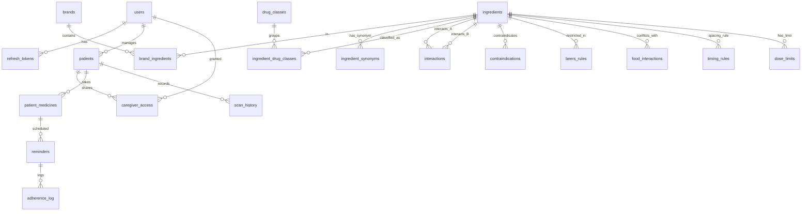
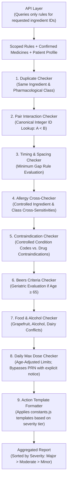
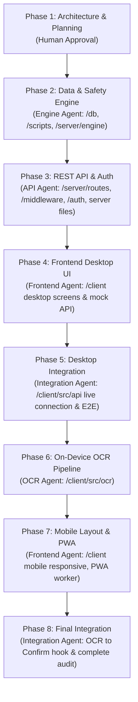

# Revision History

## Changes in Revision 3

1. **Strict Input Boundary for `/api/check`:**
   - `/api/check` strictly accepts confirmed `brandId` integers and an `unrecognized` array of raw strings.
   - Raw free-text strings are exclusively processed by `/api/medicines/normalize` prior to the mandatory user confirm step.
   - Removed all `brandId: null` or raw custom string representations from `/api/check` payloads.

2. **Negative Tests Contextualized to Fixed Test Datasets:**
   - Clarified that negative interaction tests are evaluated against a small fixed test dataset where the pair is known to be absent, validating engine mechanics.
   - Explicitly eliminated any claim or assertion that real-world drug pairs have no clinical interaction.

3. **Database-Level Row-Level Security (RLS) Hardening:**
   - Mandated execution of `SET LOCAL app.current_user_id = '...'` within each database transaction on checked-out pool connections.
   - Required application connection pool to connect as a dedicated, non-owner, non-superuser role (`medguard_app_user`).
   - Applied `FORCE ROW LEVEL SECURITY` to all five user-scoped tables (`patients`, `patient_medicines`, `scan_history`, `reminders`, `adherence_log`).
   - Standardized RLS policies on `scan_history`, `reminders`, and `adherence_log` to support shared caregiver delegation via `caregiver_access`.

4. **`ingredient_synonyms` Table & Synonym Resolution:**
   - Added `ingredient_synonyms` relational table (e.g., mapping `acetaminophen` to canonical `paracetamol`).
   - Enforced synonym resolution across `normalizer.js`, `import-ddinter.js`, and `import-indian-brands.js`.
   - Added explicit unit tests verifying synonym handling.

5. **Severity-Based Action Text Templates in `constants.js`:**
   - Replaced per-row database action text with centralized, fixed severity-based templates defined in `server/engine/constants.js`.
   - Never uses per-row custom advice and never uses an LLM.
   - Updated unverified starter test specifications to assert exact matches against these standardized templates.

6. **As-Needed (PRN) Dosing Support (`is_prn`):**
   - Added `is_prn BOOLEAN DEFAULT FALSE` to `patient_medicines`.
   - Specified that `doseChecker.js` outputs `"Cannot calculate daily total for as-needed (PRN) medicine"` instead of guessing or estimating daily doses.

7. **Controlled Vocabularies for Allergies and Conditions:**
   - Replaced free-text allergy and condition fields with controlled vocabularies:
     - Allergies: Structured references to controlled ingredient IDs and drug class IDs (`[{"type": "ingredient", "id": 12}, {"type": "class", "id": 4}]`).
     - Conditions: Standardized alphanumeric clinical condition codes (e.g., `CKD`, `HEART_FAILURE`, `ASTHMA`).
   - Updated `contraindications` schema to reference controlled `condition_code`.

8. **Name-Based Seed Files with Dynamic ID Resolution:**
   - Seed JSON files reference ingredients and classes by standardized text name (human-readable and resilient).
   - `scripts/seed.js` dynamically resolves and links integer primary/foreign keys during ingestion.

9. **Targeted / Scoped Rule Loading in API:**
   - Rather than loading the entire interaction database into memory, the API queries only the rules relevant to the specific ingredient IDs present in the request.
   - Passes these scoped rule subsets into the pure `runAllChecks()` engine function.

10. **Terminology & Neutral Language Refinement:**
    - In starter pair #2 (Aspirin + Ibuprofen), replaced "safe pain relief options" with "alternative pain relief options".
    - Removed all occurrences of the word "safe" from the glossary and architectural text.

11. **Folder Ownership, Configuration Paths & Upstream Documentation Notes:**
    - Clarified frontend API ownership: Frontend Agent scaffolds `/client/src/api` with mocked clients during Phase 4; Integration Agent connects live endpoints in Phase 5.
    - Standardized `.env.example` path to `server/.env.example`.
    - Documented required updates to be made by human in `AGENTS.md` (Section 3 folder ownership) and `docs/prompts/04a-frontend-desktop.md` (mock API scaffolding).

---

## Changes in Revision 2

*(Archived list of previous changes: small seed data, unverified starter set naming, removal of clinical advice, RLS foundation, integer foreign keys, structured dosing, and CRUD endpoints).*

---

# MedGuard: Master Engineering Implementation Plan

> [!IMPORTANT]
> **Core Safety Directive:** MedGuard is a medical polypharmacy screening tool. All drug interaction, duplicate, timing, allergy, contraindication, and dose checks are **100% deterministic** (driven strictly by curated database rules, never by AI or LLM guesses). We **never use the word "safe"**—when no issues are found, the system explicitly reports: *"No known interaction found in our data."*

---

## 1. Plain-Language Glossary for Agentic Engineering

Because you are new to agentic engineering, here is a simple translation of key technical concepts used throughout this plan:

| Term | Simple Definition | Why It Matters for MedGuard |
|---|---|---|
| **Agentic Engineering** | Building software using specialized AI agents, where each agent has strict boundaries, owns specific folders, and follows strict rules. | Prevents AI agents from overwriting each other's code or making unauthorized changes to critical safety logic. |
| **Deterministic Engine** | Code that always produces the exact same answer given the same input, using fixed rules and verified database tables. | We never let an AI "hallucinate" or guess whether two drugs interact. Lives depend on deterministic correctness. |
| **Active Ingredient vs. Brand** | A **brand** is the commercial name (e.g., *Crocin* or *Dolo 650*), while the **active ingredient** is the chemical that does the work (both are *Paracetamol*). | Patients frequently take two different brands containing the exact same chemical, risking accidental toxic overdose. |
| **Normalization** | The process of taking messy text or brand names (e.g., *"Pan-D tablet"*) and mapping them to their ingredients (*Pantoprazole 40mg + Domperidone 30mg*). | Allows the safety engine to evaluate interactions based on standard international chemical identifiers. |
| **Ingredient Synonyms** | A lookup table connecting alternative chemical names (e.g., *Acetaminophen* = *Paracetamol*). | Ensures that drug data from different international registries matches consistently. |
| **Controlled Vocabulary** | A standardized, pre-defined list of terms, IDs, or codes used instead of free-form typing. | Eliminates typographical errors and ambiguities when evaluating patient allergies and chronic medical conditions. |
| **RxNorm / RxCUI** | A standardized catalog of clinical drugs created by the US National Library of Medicine. Each ingredient has an ID called an RxCUI. | Provides a universal identifier to link Indian brands to global interaction databases. |
| **Beers Criteria** | A clinical guideline published by the American Geriatrics Society listing medications that are potentially inappropriate for adults aged 65 and older. | Elderly bodies process medicines differently; certain sleeping pills, allergy medicines, or pain relievers can cause falls, confusion, or urinary retention. |
| **SQL Schema & Migration** | The blueprint of the database tables (Schema) and safe, incremental step-by-step update scripts (Migrations). | Keeps database changes versioned, reversible, and consistent across development and production. |
| **Row-Level Security (RLS)** | A database security rule ensuring a user can only read or modify rows that belong to them. | Provides an in-depth defensive layer ensuring one caregiver cannot access another caregiver's patient health data. |
| **JWT (JSON Web Token)** | A secure, signed digital badge issued upon login that the browser sends with every request to prove identity. | Ensures that only authenticated caregivers can access their loved ones' records. |
| **Web Worker** | A background script running inside the user's web browser that executes heavy tasks without freezing the visual interface. | OCR strip scanning is computationally heavy; running it in a Web Worker keeps the app responsive and smooth. |
| **PWA (Progressive Web App)** | A website built with modern web technologies that can be installed on an Android or iOS home screen like a native mobile app and works offline. | Caregivers can install MedGuard directly from the browser without needing an app store. |

---

## 2. Final Folder Structure & Ownership

Strict folder ownership guarantees that no agent touches files outside its designated domain, adhering to `AGENTS.md` Section 3.

```
MedGuard/
├── AGENTS.md                                # Human only: master project rules
├── README.md                               # Human only: project overview & roadmap
│
├── docs/                                   # Human only (edits only on explicit request)
│   ├── PRD.md                              # Product requirements document
│   ├── PLAN.md                             # Approved master implementation plan
│   └── design/                             # Approved UI design system & Stitch export
│
├── db/                                     # Owner: Engine Agent
│   ├── migrations/                         # Sequential SQL migration files
│   │   ├── 001_initial_schema.sql          # Users, refresh_tokens, patients, access, audit
│   │   ├── 002_drug_catalog.sql            # Ingredients, synonyms, classes, brands, brand_ingredients
│   │   ├── 003_safety_rules.sql            # Interactions, contraindications, beers, food, timing, dose_limits
│   │   ├── 004_patient_records.sql         # Patient medicines (with is_prn), scan history, reminders, adherence
│   │   └── 005_indexes_and_rls.sql         # Performance indexes, trigram search, session-based RLS
│   ├── seeds/                              # Minimal sample seed data (30-50 brands, names resolved by seed.js)
│   │   ├── sample_indian_brands.json       # Labeled: MedGuard sample data (not clinically verified)
│   │   ├── sample_ingredients.json         # Ingredients with classes, synonyms, and age-adjusted dose limits
│   │   ├── sample_interactions.json        # Small starter interaction set (references ingredient names)
│   │   └── sample_safety_rules.json        # Sample Beers, timing, contraindications, food rules
│   └── dbClient.js                         # PostgreSQL connection pool (DATABASE_URL, non-superuser role)
│
├── scripts/                                # Owner: Engine Agent
│   ├── migrate.js                          # Applies SQL migrations in sequential order
│   ├── seed.js                             # Loads minimal sample data and resolves names to IDs
│   ├── import-ddinter.js                   # Ingests user-downloaded DDInter dataset (using synonyms)
│   ├── import-indian-brands.js             # Ingests user-provided Indian brand CSV (using synonyms)
│   └── verify-db.js                        # Health check verifying tables, foreign keys, row counts
│
├── server/                                 # Backend application
│   ├── server.js                           # Owner: API Agent (server entrypoint)
│   ├── app.js                              # Owner: API Agent (Express setup & middleware pipeline)
│   ├── config.js                           # Owner: API Agent (env validation via dotenv)
│   ├── .env.example                        # Owner: API Agent (template of required keys)
│   │
│   ├── auth/                               # Owner: API Agent
│   │   ├── authService.js                  # Password hashing (bcrypt) & JWT signing
│   │   └── tokenService.js                 # Refresh token lifecycle, rotation & revocation
│   │
│   ├── middleware/                         # Owner: API Agent
│   │   ├── authenticate.js                 # JWT verification & req.user attachment
│   │   ├── validate.js                     # Request schema validation
│   │   ├── rateLimiter.js                  # IP & user rate limiting for auth and check routes
│   │   └── errorHandler.js                 # Centralized error handler (NEVER logs patient/drug data)
│   │
│   ├── routes/                             # Owner: API Agent
│   │   ├── authRoutes.js                   # Register, login, refresh, logout, delete account
│   │   ├── patientRoutes.js                # Patient CRUD & patient medicines CRUD
│   │   ├── medicineRoutes.js               # Autocomplete search & brand normalization (/normalize)
│   │   ├── checkRoutes.js                  # Core safety check endpoint (/api/check) with scoped rule queries
│   │   └── reportRoutes.js                 # One-page PDF report generation
│   │
│   ├── tests/                              # Owner: API Agent
│   │   ├── auth.test.js                    # Auth endpoints, token refresh, and rate limiting tests
│   │   ├── patients.test.js                # Patient CRUD, scoping, and medicine CRUD tests
│   │   └── check.test.js                   # Safety check route validation & error handling tests
│   │
│   └── engine/                             # Owner: Engine Agent
│       ├── index.js                        # Orchestrator: runAllChecks(patient, confirmedMedicines, scopedRules)
│       ├── normalizer.js                   # Resolves brands & synonyms to ingredients & combinations
│       ├── duplicateChecker.js             # Detects duplicate ingredients and duplicate drug classes
│       ├── interactionChecker.js           # Pairwise interaction checker (canonical integer A < B)
│       ├── timingChecker.js                # Administration spacing conflict checker
│       ├── allergyChecker.js               # Controlled allergy & cross-sensitivity class checker
│       ├── contraindicationChecker.js      # Controlled disease code contraindication checker
│       ├── beersChecker.js                 # Beers Criteria validator for patients age >= 65
│       ├── foodChecker.js                  # Food & alcohol interaction rules
│       ├── doseChecker.js                  # Daily max dose checker (supports is_prn flag)
│       ├── constants.js                    # Severity definitions, standard action templates, disclaimer
│       └── tests/                          # Safety engine unit & unverified starter test suite
│           ├── starter-pairs.json          # Unverified starter set (33 dangerous pairs + negatives)
│           ├── normalizer.test.js          # Includes synonym resolution unit test
│           ├── duplicateChecker.test.js
│           ├── interactionChecker.test.js
│           ├── timingChecker.test.js
│           ├── allergyChecker.test.js
│           ├── contraindicationChecker.test.js
│           ├── beersChecker.test.js
│           ├── foodChecker.test.js
│           ├── doseChecker.test.js
│           └── engine.test.js              # Full pipeline golden suite with unverified starter set
│
├── client/                                 # Frontend application (React + Vite + Tailwind)
│   ├── index.html                          # HTML shell with viewport, Noto Sans, PWA meta
│   ├── vite.config.js                      # Vite bundler configuration
│   ├── tailwind.config.js                  # Exact tokens from Serene Clinical Assurance design
│   ├── postcss.config.js
│   ├── package.json
│   ├── public/                             # PWA assets
│   │   ├── manifest.webmanifest            # Installable web app manifest
│   │   ├── favicon.ico
│   │   └── icons/                          # PWA icons (192x192, 512x512)
│   │
│   └── src/                                # Owner: Frontend Agent (except src/ocr)
│       ├── main.jsx                        # React root mounting
│       ├── App.jsx                         # Router configuration and global providers
│       ├── index.css                       # Design tokens, typography base, accessibility resets
│       │
│       ├── api/                            # Scaffolding & Mocks: Frontend Agent (Phase 4); Live API: Integration Agent (Phase 5)
│       │   ├── client.js                   # Fetch/Axios instance with auth interceptors
│       │   ├── authApi.js                  # Auth calls (login, register, refresh, logout, delete account)
│       │   ├── patientApi.js               # Patient CRUD & patient medicine list calls
│       │   ├── medicineApi.js              # Search and normalization calls
│       │   └── checkApi.js                 # Safety check call
│       │
│       ├── mocks/                          # Mocked backend data for isolated UI dev
│       │   ├── mockPatients.js
│       │   ├── mockMedicines.js
│       │   ├── mockReport.js
│       │   └── mockSchedule.js             # Mock data for deferred reminders & schedule features
│       │
│       ├── context/                        # Global state management
│       │   ├── AuthContext.jsx             # Caregiver session state
│       │   ├── PatientContext.jsx          # Selected active patient
│       │   ├── LanguageContext.jsx         # English / Hindi switcher
│       │   └── TextSizeContext.jsx         # Large-text mode scaling
│       │
│       ├── i18n/                           # Multilingual translations
│       │   ├── en.json                     # English strings (source of truth)
│       │   ├── hi.json                     # Hindi strings stub
│       │   └── index.js                    # Translation hook
│       │
│       ├── components/                     # Reusable design system components
│       │   ├── common/
│       │   │   ├── Button.jsx              # 52px touch-friendly primary/secondary button
│       │   │   ├── Card.jsx                # Tier 1 rounded card container with 1.5px border
│       │   │   ├── Chip.jsx                # Dismissible condition/allergy tag
│       │   │   ├── Input.jsx               # 56px input with 18px text and clear button
│       │   │   ├── SeverityBadge.jsx       # Icon + Label + Fill (never color alone)
│       │   │   ├── FindingCard.jsx         # Structured finding with doctor-consultation action
│       │   │   ├── DoseLimitBar.jsx        # Visual progress bar for max daily dose
│       │   │   ├── PrivacyPromiseBanner.jsx# "Your photos stay on this phone" banner
│       │   │   ├── DisclaimerFooter.jsx    # Mandatory screening tool disclaimer
│       │   │   ├── EmptyState.jsx
│       │   │   └── LoadingState.jsx
│       │   │
│       │   └── layout/
│       │       ├── AppShell.jsx            # Responsive wrapper (desktop sidebar / mobile bottom)
│       │       ├── Sidebar.jsx             # Desktop left navigation (1280px+)
│       │       ├── TopBar.jsx              # Header with language/text toggle & user menu
│       │       └── BottomNav.jsx           # Mobile 4-tab bottom navigation (Home/Scan/Schedule/Settings)
│       │
│       ├── pages/                          # Application screens (match Stitch export)
│       │   ├── WelcomeLoginPage.jsx        # 1. Welcome / Login / Register
│       │   ├── HomeDashboardPage.jsx       # 2. Home dashboard
│       │   ├── PatientDetailPage.jsx       # 3. Patient detail view
│       │   ├── ScanPage.jsx                # 4. Medicine strip scanner (camera / upload)
│       │   ├── ConfirmMedicinesPage.jsx    # 5. Confirm & edit detected medicines (outputs brandIds)
│       │   ├── SafetyReportPage.jsx        # 6. Safety report (with print stylesheet)
│       │   ├── PatientProfileFormPage.jsx  # 7. Add/edit patient profile (uses controlled codes)
│       │   ├── SchedulePage.jsx            # 8. Daily schedule & reminders (mocked backend in v1)
│       │   ├── EmergencyCardPage.jsx       # 9. Emergency medical card
│       │   └── SettingsPage.jsx            # 10. Caregiver settings & delete account
│       │
│       ├── __tests__/                      # Frontend unit and component tests
│       │   ├── Button.test.jsx
│       │   ├── SeverityBadge.test.jsx
│       │   ├── FindingCard.test.jsx
│       │   └── ConfirmMedicinesPage.test.jsx
│       │
│       └── ocr/                            # Owner: OCR Agent ONLY
│           ├── index.js                    # Exported public scanStrip(imageFile) hook
│           ├── imagePreprocessor.js        # Canvas: resize, grayscale, contrast, threshold, deskew
│           ├── ocrWorker.js                # Tesseract.js running in dedicated Web Worker
│           ├── candidateExtractor.js       # Heuristic parser removing batch/price/dates
│           ├── fuzzyMatcher.js             # Fuse.js brand/ingredient matcher with confidence
│           └── tests/                      # Local evaluation script for /test-assets
│               └── evaluate-ocr.js
│
├── test-assets/                            # Sample blister strip photos for OCR testing
```

---

## 3. SQL Schema & Migration Plan

The database runs on standard PostgreSQL (connecting via `DATABASE_URL` as a non-owner, non-superuser role: `medguard_app_user`).

### Data Architecture Overview



---

### Migration 001: Initial Schema & Accounts (`001_initial_schema.sql`)

```sql
CREATE EXTENSION IF NOT EXISTS "uuid-ossp";
CREATE EXTENSION IF NOT EXISTS "pg_trgm";

-- Caregiver accounts
CREATE TABLE users (
    id UUID PRIMARY KEY DEFAULT uuid_generate_v4(),
    name VARCHAR(255) NOT NULL,
    email VARCHAR(255) UNIQUE NOT NULL,
    password_hash VARCHAR(255) NOT NULL,
    language VARCHAR(10) DEFAULT 'en',
    created_at TIMESTAMPTZ DEFAULT NOW(),
    updated_at TIMESTAMPTZ DEFAULT NOW()
);

-- Refresh tokens for rotation and session revocation
CREATE TABLE refresh_tokens (
    id UUID PRIMARY KEY DEFAULT uuid_generate_v4(),
    user_id UUID NOT NULL REFERENCES users(id) ON DELETE CASCADE,
    token_hash VARCHAR(255) NOT NULL,
    expires_at TIMESTAMPTZ NOT NULL,
    revoked BOOLEAN DEFAULT FALSE,
    created_at TIMESTAMPTZ DEFAULT NOW()
);

-- Patient profiles
-- Controlled vocabulary: allergies stores array of ingredient/class IDs: [{"type":"ingredient","id":12}]
-- Controlled vocabulary: conditions stores array of fixed uppercase condition codes: ["CKD", "ASTHMA"]
CREATE TABLE patients (
    id UUID PRIMARY KEY DEFAULT uuid_generate_v4(),
    caregiver_id UUID NOT NULL REFERENCES users(id) ON DELETE CASCADE,
    name VARCHAR(255) NOT NULL,
    dob DATE NOT NULL,
    weight_kg NUMERIC(5,2),
    allergies JSONB DEFAULT '[]'::jsonb,
    conditions JSONB DEFAULT '[]'::jsonb,
    created_at TIMESTAMPTZ DEFAULT NOW(),
    updated_at TIMESTAMPTZ DEFAULT NOW()
);

-- Multi-caregiver sharing & access control
CREATE TABLE caregiver_access (
    id UUID PRIMARY KEY DEFAULT uuid_generate_v4(),
    patient_id UUID NOT NULL REFERENCES patients(id) ON DELETE CASCADE,
    user_id UUID NOT NULL REFERENCES users(id) ON DELETE CASCADE,
    role VARCHAR(50) DEFAULT 'viewer',        -- 'owner', 'editor', 'viewer'
    expires_at TIMESTAMPTZ,
    UNIQUE(patient_id, user_id)
);

-- Audit log (NEVER logs medicine names or patient names)
CREATE TABLE audit_log (
    id UUID PRIMARY KEY DEFAULT uuid_generate_v4(),
    user_id UUID REFERENCES users(id) ON DELETE SET NULL,
    action VARCHAR(100) NOT NULL,
    created_at TIMESTAMPTZ DEFAULT NOW()
);
```

---

### Migration 002: Drug Catalog, Synonyms & Class Hierarchy (`002_drug_catalog.sql`)

```sql
-- Standardized active ingredients
CREATE TABLE ingredients (
    id SERIAL PRIMARY KEY,
    name VARCHAR(255) UNIQUE NOT NULL,       -- Canonical normalized lowercase: 'paracetamol'
    rxcui VARCHAR(50)                        -- RxNorm Identifier (e.g., '161')
);

-- Ingredient alternative synonyms (e.g., acetaminophen -> paracetamol)
CREATE TABLE ingredient_synonyms (
    id SERIAL PRIMARY KEY,
    ingredient_id INT NOT NULL REFERENCES ingredients(id) ON DELETE CASCADE,
    synonym VARCHAR(255) UNIQUE NOT NULL     -- Lowercase: 'acetaminophen'
);

-- Pharmacological drug classes (for allergy cross-checks and duplicate therapy)
CREATE TABLE drug_classes (
    id SERIAL PRIMARY KEY,
    name VARCHAR(255) UNIQUE NOT NULL,       -- e.g., 'NSAID', 'ACE Inhibitor', 'SSRI'
    description TEXT
);

-- Many-to-many relationship: Ingredients to Drug Classes
CREATE TABLE ingredient_drug_classes (
    ingredient_id INT NOT NULL REFERENCES ingredients(id) ON DELETE CASCADE,
    drug_class_id INT NOT NULL REFERENCES drug_classes(id) ON DELETE CASCADE,
    PRIMARY KEY (ingredient_id, drug_class_id)
);

-- Commercial brands (loaded via sample seed or Indian brand CSV importer)
CREATE TABLE brands (
    id SERIAL PRIMARY KEY,
    brand_name VARCHAR(255) NOT NULL,        -- e.g., 'Dolo 650', 'Pan-D'
    manufacturer VARCHAR(255),               -- e.g., 'Micro Labs', 'Alkem'
    form VARCHAR(100),                       -- 'tablet', 'capsule', 'syrup'
    strength_raw VARCHAR(100)                -- '650mg', '40mg/30mg'
);

-- Multi-ingredient mapping (Combination product resolver)
CREATE TABLE brand_ingredients (
    id SERIAL PRIMARY KEY,
    brand_id INT NOT NULL REFERENCES brands(id) ON DELETE CASCADE,
    ingredient_id INT NOT NULL REFERENCES ingredients(id) ON DELETE CASCADE,
    strength_mg NUMERIC(10,2) NOT NULL,
    UNIQUE(brand_id, ingredient_id)
);
```

---

### Migration 003: Safety Rules & Limits (`003_safety_rules.sql`)

```sql
-- Pairwise drug-drug interactions (DDInter / TWOSIDES import)
-- CRITICAL SAFETY RULE: Enforces canonical integer ordering (ingredient_a < ingredient_b)
-- Note: 'action' is generated by engine templates in constants.js, not stored as per-row advice.
CREATE TABLE interactions (
    id SERIAL PRIMARY KEY,
    ingredient_a INT NOT NULL REFERENCES ingredients(id) ON DELETE CASCADE,
    ingredient_b INT NOT NULL REFERENCES ingredients(id) ON DELETE CASCADE,
    severity VARCHAR(20) NOT NULL,           -- 'major', 'moderate', 'minor'
    summary VARCHAR(500) NOT NULL,
    explanation TEXT NOT NULL,
    source VARCHAR(100) NOT NULL,            -- e.g., 'DDInter v2.0' or 'MedGuard sample data (not clinically verified)'
    CONSTRAINT chk_canonical_order CHECK (ingredient_a < ingredient_b),
    UNIQUE(ingredient_a, ingredient_b)
);

-- Administration timing & spacing conflicts
CREATE TABLE timing_rules (
    id SERIAL PRIMARY KEY,
    ingredient_a INT NOT NULL REFERENCES ingredients(id) ON DELETE CASCADE,
    ingredient_b INT NOT NULL REFERENCES ingredients(id) ON DELETE CASCADE,
    min_gap_hours NUMERIC(4,1) NOT NULL,     -- e.g., 2.0 or 4.0 hours
    severity VARCHAR(20) DEFAULT 'moderate',
    advice TEXT NOT NULL,
    source VARCHAR(100) NOT NULL,
    CONSTRAINT chk_timing_order CHECK (ingredient_a < ingredient_b),
    UNIQUE(ingredient_a, ingredient_b)
);

-- Disease-drug contraindications using controlled condition codes
CREATE TABLE contraindications (
    id SERIAL PRIMARY KEY,
    ingredient_id INT NOT NULL REFERENCES ingredients(id) ON DELETE CASCADE,
    condition_code VARCHAR(50) NOT NULL,     -- Controlled: 'CKD', 'HEART_FAILURE', 'ASTHMA'
    severity VARCHAR(20) NOT NULL,           -- 'major', 'moderate'
    description TEXT NOT NULL,
    source VARCHAR(100) NOT NULL
);

-- Beers Criteria for elderly patients (age 65+)
CREATE TABLE beers_rules (
    id SERIAL PRIMARY KEY,
    ingredient_id INT NOT NULL REFERENCES ingredients(id) ON DELETE CASCADE,
    rationale TEXT NOT NULL,
    recommendation TEXT NOT NULL,
    severity VARCHAR(20) DEFAULT 'major',
    source VARCHAR(100) DEFAULT 'AGS Beers Criteria 2023'
);

-- Food and alcohol interactions
CREATE TABLE food_interactions (
    id SERIAL PRIMARY KEY,
    ingredient_id INT NOT NULL REFERENCES ingredients(id) ON DELETE CASCADE,
    item VARCHAR(100) NOT NULL,              -- 'alcohol', 'grapefruit', 'dairy'
    severity VARCHAR(20) NOT NULL,           -- 'major', 'moderate', 'minor'
    description TEXT NOT NULL,
    source VARCHAR(100) NOT NULL
);

-- Age-adjusted maximum daily dose limits
CREATE TABLE dose_limits (
    id SERIAL PRIMARY KEY,
    ingredient_id INT NOT NULL REFERENCES ingredients(id) ON DELETE CASCADE,
    age_min INT DEFAULT 0,
    age_max INT DEFAULT 150,
    max_daily_dose_mg NUMERIC(10,2) NOT NULL,
    unit VARCHAR(20) DEFAULT 'mg',
    rationale TEXT,
    source VARCHAR(100) NOT NULL
);
```

---

### Migration 004: Patient Medicines & Records (`004_patient_records.sql`)

```sql
-- Active medicines recorded for a patient
CREATE TABLE patient_medicines (
    id UUID PRIMARY KEY DEFAULT uuid_generate_v4(),
    patient_id UUID NOT NULL REFERENCES patients(id) ON DELETE CASCADE,
    brand_id INT REFERENCES brands(id) ON DELETE SET NULL,
    custom_name VARCHAR(255),
    dose_amount NUMERIC(8,2),                -- e.g., 1 or 500
    dose_unit VARCHAR(50),                   -- e.g., 'tablet', 'mg', 'ml'
    doses_per_day INT NOT NULL DEFAULT 1,    -- e.g., 1, 2, 3
    is_prn BOOLEAN DEFAULT FALSE,            -- TRUE = as-needed medicine (dose total bypassed)
    frequency_text VARCHAR(100),             -- 'twice daily with food'
    timing_schedule JSONB DEFAULT '[]'::jsonb, -- e.g., ["08:00", "20:00"]
    start_date DATE,
    end_date DATE,
    active BOOLEAN DEFAULT TRUE,
    created_at TIMESTAMPTZ DEFAULT NOW()
);

-- Scan history log (NEVER stores photos - privacy guarantee)
CREATE TABLE scan_history (
    id UUID PRIMARY KEY DEFAULT uuid_generate_v4(),
    patient_id UUID NOT NULL REFERENCES patients(id) ON DELETE CASCADE,
    matched_drugs JSONB NOT NULL,            -- Detected medicines and match confidence
    confidence NUMERIC(4,2),                 -- Average confidence score (0.0 to 1.0)
    created_at TIMESTAMPTZ DEFAULT NOW()
);

-- Reminders & adherence (Backend deferred in v1; schema established for future migration)
CREATE TABLE reminders (
    id UUID PRIMARY KEY DEFAULT uuid_generate_v4(),
    patient_medicine_id UUID NOT NULL REFERENCES patient_medicines(id) ON DELETE CASCADE,
    reminder_time TIME NOT NULL,
    status VARCHAR(20) DEFAULT 'active'      -- 'active', 'paused'
);

CREATE TABLE adherence_log (
    id UUID PRIMARY KEY DEFAULT uuid_generate_v4(),
    reminder_id UUID NOT NULL REFERENCES reminders(id) ON DELETE CASCADE,
    status VARCHAR(20) NOT NULL,             -- 'taken', 'missed', 'skipped'
    logged_at TIMESTAMPTZ DEFAULT NOW()
);
```

---

### Migration 005: Indexes & Defense-in-Depth RLS (`005_indexes_and_rls.sql`)

```sql
-- Indexes for rapid lookups and fuzzy autocomplete
CREATE INDEX idx_brands_name_trgm ON brands USING gin (lower(brand_name) gin_trgm_ops);
CREATE INDEX idx_ingredients_name ON ingredients (lower(name));
CREATE INDEX idx_ingredient_synonyms_name ON ingredient_synonyms (lower(synonym));
CREATE INDEX idx_interactions_lookup ON interactions (ingredient_a, ingredient_b);
CREATE INDEX idx_timing_lookup ON timing_rules (ingredient_a, ingredient_b);
CREATE INDEX idx_patient_medicines_active ON patient_medicines (patient_id) WHERE active = TRUE;
CREATE INDEX idx_refresh_tokens_user ON refresh_tokens (user_id);

-- ROW LEVEL SECURITY (RLS) - SECOND-LAYER DEFENSE
-- Primary protection: API-level query filtering (WHERE caregiver_id = current_user_id)
-- Second-layer protection: Database RLS enforced on checked-out pool connections
-- Pool connects as unprivileged role: medguard_app_user (non-owner, non-superuser)
-- Each transaction executes: SET LOCAL app.current_user_id = '<authenticated_uuid>';

ALTER TABLE patients ENABLE ROW LEVEL SECURITY;
ALTER TABLE patient_medicines ENABLE ROW LEVEL SECURITY;
ALTER TABLE scan_history ENABLE ROW LEVEL SECURITY;
ALTER TABLE reminders ENABLE ROW LEVEL SECURITY;
ALTER TABLE adherence_log ENABLE ROW LEVEL SECURITY;

-- Enforce RLS even for table owners/service accounts
ALTER TABLE patients FORCE ROW LEVEL SECURITY;
ALTER TABLE patient_medicines FORCE ROW LEVEL SECURITY;
ALTER TABLE scan_history FORCE ROW LEVEL SECURITY;
ALTER TABLE reminders FORCE ROW LEVEL SECURITY;
ALTER TABLE adherence_log FORCE ROW LEVEL SECURITY;

-- Helper function to extract the session-scoped user ID
CREATE OR REPLACE FUNCTION get_current_user_id() RETURNS UUID AS $$
BEGIN
    RETURN NULLIF(current_setting('app.current_user_id', true), '')::UUID;
EXCEPTION
    WHEN OTHERS THEN RETURN NULL;
END;
$$ LANGUAGE plpgsql STABLE;

-- RLS Policy: Patients table (Caregiver owner or granted delegate)
CREATE POLICY rls_patients_policy ON patients
    FOR ALL
    USING (
        caregiver_id = get_current_user_id() 
        OR id IN (SELECT patient_id FROM caregiver_access WHERE user_id = get_current_user_id())
    );

-- RLS Policy: Patient Medicines table (Consistent with caregiver_access)
CREATE POLICY rls_patient_medicines_policy ON patient_medicines
    FOR ALL
    USING (
        patient_id IN (
            SELECT id FROM patients 
            WHERE caregiver_id = get_current_user_id()
               OR id IN (SELECT patient_id FROM caregiver_access WHERE user_id = get_current_user_id())
        )
    );

-- RLS Policy: Scan History table (Consistent with caregiver_access)
CREATE POLICY rls_scan_history_policy ON scan_history
    FOR ALL
    USING (
        patient_id IN (
            SELECT id FROM patients 
            WHERE caregiver_id = get_current_user_id()
               OR id IN (SELECT patient_id FROM caregiver_access WHERE user_id = get_current_user_id())
        )
    );

-- RLS Policy: Reminders table (Consistent with caregiver_access)
CREATE POLICY rls_reminders_policy ON reminders
    FOR ALL
    USING (
        patient_medicine_id IN (
            SELECT pm.id FROM patient_medicines pm
            JOIN patients p ON pm.patient_id = p.id
            WHERE p.caregiver_id = get_current_user_id()
               OR p.id IN (SELECT patient_id FROM caregiver_access WHERE user_id = get_current_user_id())
        )
    );

-- RLS Policy: Adherence Log table (Consistent with caregiver_access)
CREATE POLICY rls_adherence_log_policy ON adherence_log
    FOR ALL
    USING (
        reminder_id IN (
            SELECT r.id FROM reminders r
            JOIN patient_medicines pm ON r.patient_medicine_id = pm.id
            JOIN patients p ON pm.patient_id = p.id
            WHERE p.caregiver_id = get_current_user_id()
               OR p.id IN (SELECT patient_id FROM caregiver_access WHERE user_id = get_current_user_id())
        )
    );
```

---

## 4. REST API Contract

All endpoints run on Express, require `Content-Type: application/json`, and return consistent envelope responses. Endpoints marked 🔒 require `Authorization: Bearer <accessToken>`.

### Error Response Envelope
```json
{
  "success": false,
  "error": {
    "code": "VALIDATION_ERROR | UNAUTHORIZED | FORBIDDEN | NOT_FOUND | RATE_LIMITED | INTERNAL_ERROR",
    "message": "Human-friendly explanation of the issue."
  }
}
```

---

### Auth Endpoints

#### 1. `POST /api/auth/register`
* **Request Body:** `{ "name": "Priya Sharma", "email": "priya.sharma@example.com", "password": "StrongPassword123!", "language": "en" }`
* **Success Response (201 Created):** `{ "success": true, "data": { "user": { "id": "...", "name": "Priya Sharma" }, "tokens": { "accessToken": "...", "refreshToken": "..." } } }`

#### 2. `POST /api/auth/login`
Rate limited: 5 attempts per 15 minutes per IP.
* **Request Body:** `{ "email": "priya.sharma@example.com", "password": "StrongPassword123!" }`
* **Success Response (200 OK):** `{ "success": true, "data": { "user": { "id": "..." }, "tokens": { "accessToken": "...", "refreshToken": "..." } } }`

#### 3. `POST /api/auth/refresh`
Rotates the refresh token and returns a new access token.
* **Request Body:** `{ "refreshToken": "d82f48ab..." }`
* **Success Response (200 OK):** `{ "success": true, "data": { "accessToken": "...", "refreshToken": "..." } }`

#### 4. `POST /api/auth/logout` 🔒
Revokes the refresh token.
* **Request Body:** `{ "refreshToken": "d82f48ab..." }`
* **Success Response (200 OK):** `{ "success": true, "message": "Logged out successfully" }`

#### 5. `DELETE /api/auth/account` 🔒
Deletes the caregiver account and cascades deletion of all associated patient data.
* **Request Body:** `{ "password": "StrongPassword123!" }`
* **Success Response (200 OK):** `{ "success": true, "message": "Account and all associated patient records permanently deleted" }`

---

### Medicine Catalog & Normalization Endpoints

#### 6. `GET /api/medicines/search?q={query}` 🔒
Autocomplete search for brands and generic ingredients.
* **Query Params:** `q` (minimum 2 chars, e.g., `dolo` or `crocin`)
* **Success Response (200 OK):** `{ "success": true, "data": [{ "id": 104, "name": "Dolo 650", "manufacturer": "Micro Labs", "strength": "650mg" }] }`

#### 7. `POST /api/medicines/normalize` 🔒
**Exclusively handles messy raw brand names or OCR strings** before presenting the confirmed list to the caregiver.
* **Request Body:** `{ "queries": ["Dolo 650", "Pan-D", "UnknownStripX"] }`
* **Success Response (200 OK):**
```json
{
  "success": true,
  "data": {
    "resolved": [
      {
        "query": "Dolo 650",
        "brandId": 104,
        "brandName": "Dolo 650",
        "ingredients": [{ "id": 1, "name": "paracetamol", "strengthMg": 650 }]
      },
      {
        "query": "Pan-D",
        "brandId": 218,
        "brandName": "Pan-D",
        "ingredients": [
          { "id": 12, "name": "pantoprazole", "strengthMg": 40 },
          { "id": 15, "name": "domperidone", "strengthMg": 30 }
        ]
      }
    ],
    "unresolved": [
      {
        "query": "UnknownStripX",
        "reason": "Not found in local brand catalog"
      }
    ]
  }
}
```

---

### Core Safety Engine Endpoint

#### 8. `POST /api/check` 🔒
Rate limited: 30 requests per minute.
**STRICT INPUT BOUNDARY:** Accepts confirmed `brandId` integers and an `unrecognized` array only. Raw strings never enter `/api/check`.
* **Request Body:**
```json
{
  "patientId": "8a32b214-41d1-42aa-91e0-bc4f285d8e20",
  "confirmedMedicines": [
    {
      "brandId": 104,
      "doseAmount": 1,
      "doseUnit": "tablet",
      "dosesPerDay": 3,
      "isPrn": false,
      "frequencyText": "three times daily"
    },
    {
      "brandId": 52,
      "doseAmount": 1,
      "doseUnit": "tablet",
      "dosesPerDay": 1,
      "isPrn": false,
      "frequencyText": "once daily evening"
    },
    {
      "brandId": 77,
      "doseAmount": 1,
      "doseUnit": "tablet",
      "dosesPerDay": 1,
      "isPrn": true,
      "frequencyText": "as needed"
    }
  ],
  "unrecognized": ["UnknownHerbalPacket"]
}
```
* **Success Response (200 OK):**
```json
{
  "success": true,
  "data": {
    "summary": {
      "overallStatus": "major",
      "totalFindings": 1,
      "majorCount": 1,
      "moderateCount": 0,
      "minorCount": 0,
      "unrecognizedCount": 1
    },
    "findings": [
      {
        "type": "interaction",
        "severity": "major",
        "items": ["Warfarin 5mg", "Disprin"],
        "summary": "Combining Warfarin and Aspirin greatly increases the risk of serious bleeding.",
        "explanation": "Warfarin slows down blood clotting, and Aspirin stops platelets from sticking together. Taking both multiplies the risk of stomach ulcers and internal bleeding.",
        "action": "Contact the patient's doctor or pharmacist today before giving these medicines together. Do not alter prescribed doses without professional guidance.",
        "source": "DDInter v2.0"
      }
    ],
    "unrecognized": [
      {
        "input": "UnknownHerbalPacket",
        "reason": "Could not identify active ingredients in catalog. Please show this packaging to a doctor or pharmacist."
      }
    ],
    "disclaimer": "MedGuard is an informational screening tool. It does not provide medical advice, diagnosis or treatment, and it does not replace consultation with a doctor or pharmacist. Never start, stop or change a medicine without professional guidance."
  }
}
```

---

### Patient & Medicine Records Endpoints

#### 9. `GET /api/patients` 🔒
Returns all patient profiles managed by the caregiver.

#### 10. `POST /api/patients` 🔒
Creates a new patient profile using controlled vocabularies.
* **Request Body:**
```json
{
  "name": "Ramesh Sharma",
  "dob": "1954-04-12",
  "weightKg": 68.5,
  "allergies": [{"type": "class", "id": 4}],
  "conditions": ["CKD", "HYPERTENSION"]
}
```

#### 11. `PUT /api/patients/:id` 🔒
Edits an existing patient profile.

#### 12. `DELETE /api/patients/:id` 🔒
Permanently deletes a patient profile and associated medicine records.

#### 13. `GET /api/patients/:id/medicines` 🔒
Retrieves active medicines for a patient.

#### 14. `POST /api/patients/:id/medicines` 🔒
Saves confirmed medicines to the patient's record.

#### 15. `DELETE /api/patients/:id/medicines/:medId` 🔒
Removes a medicine from the patient's active list.

#### 16. `GET /api/patients/:id/report.pdf` 🔒
Generates and streams a doctor-ready one-page PDF report.

---

## 5. Safety-Engine Module Design

The safety engine is built exclusively with **pure, exported functions**. Given identical inputs, it always yields identical outputs. It executes zero network calls and zero database queries during check execution.

### Architectural Workflow



### Module Responsibilities

1. **Targeted Rule Ingestion:** The Express API queries only the rules needed for the active ingredient IDs in the request and injects this scoped subset into `runAllChecks()`.
2. **`normalizer.js` (`normalize(rawMedicines, brandCatalog, synonymTable)`)**
   - Resolves brand IDs or text to integer ingredient IDs. Uses `ingredient_synonyms` to map alternative chemical names.
   - Automatically splits combination drugs.
3. **`duplicateChecker.js` (`checkDuplicates(normalizedMedicines, drugClasses)`)**
   - Detects duplicate active ingredients and duplicate pharmacological classes.
4. **`interactionChecker.js` (`checkInteractions(ingredientsList, scopedInteractions)`)**
   - Checks pairwise combinations $N \times (N - 1) / 2$ with canonical integer order (`A < B`).
5. **`timingChecker.js` (`checkTiming(normalizedMedicines, scopedTimingRules)`)**
   - Evaluates administration interval spacing.
6. **`allergyChecker.js` (`checkAllergies(patientAllergies, ingredientsList, classHierarchy)`)**
   - Matches controlled allergy entries (ingredient IDs / class IDs) against active ingredients.
7. **`contraindicationChecker.js` (`checkContraindications(patientConditions, ingredientsList, scopedContraindications)`)**
   - Cross-references controlled condition codes (e.g., `CKD`) against drug contraindications.
8. **`beersChecker.js` (`checkBeers(patientAge, ingredientsList, scopedBeersRules)`)**
   - Flags medications on the AGS Beers Criteria list for patients aged 65 and older.
9. **`foodChecker.js` (`checkFood(ingredientsList, scopedFoodRules)`)**
   - Evaluates dietary and alcohol conflicts.
10. **`doseChecker.js` (`checkMaxDose(patientAge, normalizedMedicines, scopedDoseLimits)`)**
    - Checks cumulative 24-hour milligram dose against age-adjusted limits.
    - **For as-needed medicines (`is_prn = true`):** Outputs `"Cannot calculate daily total for as-needed (PRN) medicine"` instead of guessing.
11. **Action Text Formatting via `constants.js`:**
    - Caregiver actions are generated **strictly from severity-based templates** defined in `constants.js`:
      - **Major:** *"Contact the patient's doctor or pharmacist today before giving these medicines together. Do not alter prescribed doses without professional guidance."*
      - **Moderate:** *"Discuss this combination with the patient's doctor or pharmacist at the next appointment. Monitor the patient for symptoms."*
      - **Minor:** *"Be aware of this combination and monitor the patient. Mention it to the pharmacist during your next refill."*
      - **Info / Clear:** *"No known interaction found in our data. Always verify all medicines with a doctor or pharmacist."*
    - Actions are never free-form text in data tables and are never generated by an LLM.

---

## 6. Phased Implementation Roadmap & Ownership

Tasks are organized strictly in sequential dependency order.



### Detailed Task Table

| Phase | Task Description | Scope / Folders Owned | Dependencies | Owner |
|---|---|---|---|---|
| **1.0** | Master Plan approval & repository alignment | `/docs/PLAN.md` | None | Human & Lead Engineer |
| **2.1** | Write PostgreSQL migrations (001-005) with integer IDs, synonyms, PRN, RLS | `/db/migrations/*.sql`, `/scripts/migrate.js` | 1.0 | Engine Agent |
| **2.2** | Build sample seed data (30-50 brands) & real DDInter/brand importer scripts | `/db/seeds/*.json`, `/scripts/import-*.js`, `/scripts/seed.js` | 2.1 | Engine Agent |
| **2.3** | Implement pure safety engine modules & fixed action templates in constants.js | `/server/engine/*.js` | 2.2 | Engine Agent |
| **2.4** | Build unverified starter test suite (33 pairs + fixed-dataset negatives + synonym test) | `/server/engine/tests/*` | 2.3 | Engine Agent |
| **3.1** | Express setup, config validation, PostgreSQL pool with session-based RLS | `/server/server.js`, `/server/app.js`, `/server/config.js`, `/server/.env.example` | 2.2 | API Agent |
| **3.2** | Authentication module (bcrypt, JWT, refresh rotation, account deletion) | `/server/auth/*`, `/server/middleware/authenticate.js` | 3.1 | API Agent |
| **3.3** | REST endpoints (search, normalize, check with scoped rule queries, patient/medicine CRUD) | `/server/routes/*`, `/server/middleware/rateLimiter.js` | 2.3, 3.2 | API Agent |
| **3.4** | Input validation, error handling, and API integration test suite | `/server/middleware/errorHandler.js`, `/server/tests/*` | 3.3 | API Agent |
| **4.1** | Client scaffold (Vite + React + Tailwind + Noto Sans design tokens) | `/client/package.json`, `/client/tailwind.config.js` | 1.0 | Frontend Agent |
| **4.2** | Reusable UI components (Button, Card, SeverityBadge, FindingCard) | `/client/src/components/common/*` | 4.1 | Frontend Agent |
| **4.3** | Desktop app shell (Sidebar, TopBar, Language Switcher, Text Scaling) | `/client/src/components/layout/*` | 4.2 | Frontend Agent |
| **4.4** | Desktop screens with mocked API layer in `/client/src/api` | `/client/src/pages/*`, `/client/src/api/*`, `/client/src/mocks/*` | 4.3 | Frontend Agent |
| **4.5** | Frontend component and screen unit tests (React Testing Library) | `/client/src/__tests__/*` | 4.4 | Frontend Agent |
| **5.1** | Connect frontend API layer (`/client/src/api`) to live Express API | `/client/src/api/*` | 3.4, 4.5 | Integration Agent |
| **5.2** | Verify desktop caregiver flow end-to-end in browser | Full desktop app | 5.1 | Integration Agent |
| **6.1** | Canvas image pre-processing (grayscale, contrast, threshold, deskew) | `/client/src/ocr/imagePreprocessor.js` | 1.0 | OCR Agent |
| **6.2** | Tesseract.js Web Worker integration & candidate name parser | `/client/src/ocr/ocrWorker.js`, `candidateExtractor.js` | 6.1 | OCR Agent |
| **6.3** | Fuse.js fuzzy matcher with confidence scoring & test runner | `/client/src/ocr/fuzzyMatcher.js`, `/client/src/ocr/tests/*` | 6.2 | OCR Agent |
| **7.1** | Mobile responsive layouts (360-430px) & 4-tab bottom navigation | `/client/src/components/layout/BottomNav.jsx` | 5.2 | Frontend Agent |
| **7.2** | Mobile camera scan view with guide frame & privacy promise banner | `/client/src/pages/ScanPage.jsx` | 7.1 | Frontend Agent |
| **7.3** | PWA manifest, service worker for app shell offline caching | `/client/public/manifest.webmanifest` | 7.2 | Frontend Agent |
| **8.1** | Hook OCR pipeline into Confirm Medicines screen | `/client/src/pages/ConfirmMedicinesPage.jsx`, `/client/src/api/*` | 6.3, 7.3 | Integration Agent |
| **8.2** | End-to-end verification of full mobile & desktop flow | Full application | 8.1 | Integration Agent |

---

## 7. Test Plan & Unverified Starter Set

> [!NOTE]
> **Data & Verification Notice:** This table represents an **unverified starter set** for testing the engine's rule-evaluation mechanics. The severity tiers and clinical alerts in MedGuard are not permanently hard-coded into the application logic; they are imported from source datasets (e.g., DDInter) and subject to formal licensed pharmacist review.
> 
> **Caregiver Action Rule:** Under no circumstances will MedGuard instruct a caregiver to stop, change, switch, halve, or cap any medication. All caregiver actions strictly apply the fixed severity templates from `constants.js`.

### Unverified Starter Test Pairs

| # | Pair (Ingredient A + Ingredient B) | Severity (Subject to Data & Pharmacist Review) | Clinical Mechanism & Concern | Action Template Applied (`constants.js`) |
|---|---|---|---|---|
| **1** | Warfarin + Aspirin | Major | Combined anticoagulant and antiplatelet activity; elevated risk of major internal or GI bleeding. | Major Template: Contact doctor or pharmacist today before giving these medicines together. |
| **2** | Aspirin + Ibuprofen | Major | Ibuprofen interferes with the antiplatelet cardioprotective effect of aspirin and compounds GI mucosal ulceration risk. | Major Template: Contact doctor or pharmacist today before giving these medicines together. |
| **3** | Sildenafil + Nitroglycerin | Major | Synergistic vasodilation can cause a dangerous drop in blood pressure. | Major Template: Contact doctor or pharmacist today before giving these medicines together. |
| **4** | Phenelzine + Sertraline | Major | MAO inhibitor combined with SSRI creates risk of Serotonin Syndrome. | Major Template: Contact doctor or pharmacist today before giving these medicines together. |
| **5** | Lisinopril + Spironolactone | Major | Concomitant ACE inhibitor and potassium-sparing diuretic increases risk of hyperkalemia. | Major Template: Contact doctor or pharmacist today before giving these medicines together. |
| **6** | Methotrexate + Trimethoprim | Major | Trimethoprim reduces renal clearance of methotrexate, risking bone marrow toxicity. | Major Template: Contact doctor or pharmacist today before giving these medicines together. |
| **7** | Lithium + Ibuprofen | Major | NSAIDs reduce renal elimination of lithium, risking toxic lithium accumulation. | Major Template: Contact doctor or pharmacist today before giving these medicines together. |
| **8** | Tramadol + Fluoxetine | Major | Additive serotonergic activity increases seizure risk and Serotonin Syndrome potential. | Major Template: Contact doctor or pharmacist today before giving these medicines together. |
| **9** | Clopidogrel + Omeprazole | Major | Omeprazole may diminish the activation and antiplatelet efficacy of clopidogrel. | Major Template: Contact doctor or pharmacist today before giving these medicines together. |
| **10**| Simvastatin + Clarithromycin | Major | Clarithromycin inhibits statin metabolism, significantly increasing muscle toxicity risk. | Major Template: Contact doctor or pharmacist today before giving these medicines together. |
| **11**| Digoxin + Amiodarone | Major | Amiodarone significantly increases digoxin blood concentration. | Major Template: Contact doctor or pharmacist today before giving these medicines together. |
| **12**| Ciprofloxacin + Theophylline | Major | Ciprofloxacin inhibits theophylline clearance, increasing toxicity risk. | Major Template: Contact doctor or pharmacist today before giving these medicines together. |
| **13**| Amiodarone + Levofloxacin | Major | Additive QT-interval prolongation increases risk of cardiac arrhythmias. | Major Template: Contact doctor or pharmacist today before giving these medicines together. |
| **14**| Potassium Chloride + Spironolactone | Major | Concurrent potassium supplement and potassium-sparing diuretic can cause severe hyperkalemia. | Major Template: Contact doctor or pharmacist today before giving these medicines together. |
| **15**| Warfarin + Fluconazole | Major | Fluconazole inhibits warfarin metabolism, significantly increasing bleeding risk. | Major Template: Contact doctor or pharmacist today before giving these medicines together. |
| **16**| Rivaroxaban + Ketoconazole | Major | Ketoconazole increases rivaroxaban blood levels, raising bleeding risk. | Major Template: Contact doctor or pharmacist today before giving these medicines together. |
| **17**| Allopurinol + Azathioprine | Major | Allopurinol impedes azathioprine breakdown, escalating risk of bone marrow suppression. | Major Template: Contact doctor or pharmacist today before giving these medicines together. |
| **18**| Colchicine + Clarithromycin | Major | Clarithromycin substantially raises colchicine exposure, especially in renal impairment. | Major Template: Contact doctor or pharmacist today before giving these medicines together. |
| **19**| Metoprolol + Verapamil | Major | Combined cardiodepressant effects can lead to severe bradycardia or heart block. | Major Template: Contact doctor or pharmacist today before giving these medicines together. |
| **20**| Digoxin + Furosemide | Major | Loop diuretic-induced potassium loss sensitizes the patient to digoxin toxicity. | Major Template: Contact doctor or pharmacist today before giving these medicines together. |
| **21**| Tacrolimus + Ketoconazole | Major | Ketoconazole significantly elevates tacrolimus blood levels, risking kidney toxicity. | Major Template: Contact doctor or pharmacist today before giving these medicines together. |
| **22**| Carbamazepine + Ethinylestradiol | Major | Carbamazepine accelerates estrogen breakdown, reducing oral contraceptive efficacy. | Major Template: Contact doctor or pharmacist today before giving these medicines together. |
| **23**| Sertraline + Linezolid | Major | Linezolid possesses MAO-inhibiting properties, posing Serotonin Syndrome risk with SSRIs. | Major Template: Contact doctor or pharmacist today before giving these medicines together. |
| **24**| Diazepam + Oxycodone | Major | Concomitant benzodiazepine and opioid therapy produces heightened risk of profound sedation and respiratory depression. | Major Template: Contact doctor or pharmacist today before giving these medicines together. |
| **25**| Methadone + Ciprofloxacin | Major | Ciprofloxacin may elevate methadone blood concentration and prolong the cardiac QT interval. | Major Template: Contact doctor or pharmacist today before giving these medicines together. |
| **26**| Warfarin + Ibuprofen | Major | NSAID-induced gastric irritation combined with systemic anticoagulation creates high bleeding risk. | Major Template: Contact doctor or pharmacist today before giving these medicines together. |
| **27**| Cyclosporine + Atorvastatin | Major | Cyclosporine elevates statin blood concentration, increasing risk of muscle injury. | Major Template: Contact doctor or pharmacist today before giving these medicines together. |
| **28**| Trimethoprim + Spironolactone | Major | Both agents reduce renal potassium excretion, risking dangerous hyperkalemia. | Major Template: Contact doctor or pharmacist today before giving these medicines together. |
| **29**| Ergotamine + Clarithromycin | Major | Macrolide antibiotic inhibits ergotamine clearance, creating risk of vasospasm. | Major Template: Contact doctor or pharmacist today before giving these medicines together. |
| **30**| Paroxetine + St. John's Wort | Major | Co-administration of herbal and pharmaceutical serotonergic agents elevates Serotonin Syndrome risk. | Major Template: Contact doctor or pharmacist today before giving these medicines together. |
| **31**| Diltiazem + Simvastatin | Major | Diltiazem raises simvastatin levels, increasing potential for muscle aches and toxicity. | Major Template: Contact doctor or pharmacist today before giving these medicines together. |
| **32**| Methotrexate + Naproxen | Major | NSAIDs impede methotrexate clearance, heightening risk of serious toxicity. | Major Template: Contact doctor or pharmacist today before giving these medicines together. |
| **33**| Phenytoin + Voriconazole | Major | Mutual pharmacokinetic interactions can cause elevated phenytoin toxicity or antifungal failure. | Major Template: Contact doctor or pharmacist today before giving these medicines together. |

---

### Negative Interaction Tests (Fixed Test Dataset Evaluation)

> [!IMPORTANT]
> The negative interaction tests evaluate the engine against a **small fixed test fixture in which the pairs below have zero entries in the interaction table**. This verifies that when a pair is absent from the dataset, the engine correctly returns `severity: "info"` and the exact text *"No known interaction found in our data."* It makes **no assertion** that these drug pairs have no pharmacological interaction in clinical medicine.

- Test Fixture Pair: `Ingredient A (id: 1)` + `Ingredient B (id: 99)` absent from fixture $\rightarrow$ Result: `"No known interaction found in our data."`
- Starter Test Cases evaluated against absent dataset entries:
  - `Paracetamol` + `Amoxicillin` $\rightarrow$ Result: `"No known interaction found in our data."`
  - `Atorvastatin` + `Metformin` $\rightarrow$ Result: `"No known interaction found in our data."`

---

### Unrecognized Medicine Test Case

- **Input:** `"HerbalChurnaStripX 500mg"` (submitted to `/api/medicines/normalize` and left unmapped).
- **Required Behavior:** Passed in `unrecognized` array to `/api/check`. Must **never** be dropped silently.
- **Result:** Returned in `unrecognized` array with `reason: "Could not identify active ingredients in catalog. Please show this packaging to a doctor or pharmacist."`

---

### Duplicate Therapy, Synonym & Combination Starter Tests

- **Ingredient Synonym Resolution Test:**
  - Input: Brand containing `acetaminophen` $\rightarrow$ Resolved to canonical `paracetamol` (id: 1) via `ingredient_synonyms`.
- **Exact Duplicate Ingredient:**
  - `Crocin 500` + `Dolo 650` $\rightarrow$ Flagged as **Major Duplicate**: Both contain `paracetamol`. Daily cumulative dose checked against limits.
- **Pharmacological Class Duplicate:**
  - `Brufen 400` + `Voveran 50` $\rightarrow$ Flagged as **Major Duplicate Class**: Both belong to the `NSAID` class. Action: Moderate/Major Action Template applied.
- **Combination Product Expansion:**
  - `Pan-D` expands to `pantoprazole 40mg` + `domperidone 30mg`.
  - `Augmentin 625` expands to `amoxicillin 500mg` + `clavulanic acid 125mg`.
  - `Telma-AM` expands to `telmisartan 40mg` + `amlodipine 5mg`.
- **PRN As-Needed Dosing Check:**
  - Medicine marked `is_prn: true` $\rightarrow$ Engine dose check returns `"Cannot calculate daily total for as-needed (PRN) medicine"` rather than multiplying daily total.
- **Beers Criteria Starter Test (Patient Age 74):**
  - `Alprazolam 0.5mg` $\rightarrow$ Flagged as **Beers Alert**: Increased risk of falls and cognitive impairment in older adults.
  - `Diphenhydramine 25mg` $\rightarrow$ Flagged as **Beers Alert**: Strong anticholinergic effects.

---

## 8. Technical Risks, Mitigations & Upstream Documentation Alignments

### Technical Risks & Mitigations

| Risk | Severity | Mitigation Strategy |
|---|---|---|
| **1. OCR Glare & Distorted Blister Foil** | High | Apply image pre-processing (deskew, grayscale, adaptive thresholding). Provide camera guide frame. **Mandatory Confirm-and-Edit screen** guarantees caregiver reviews OCR matches before any safety check is executed. |
| **2. Indian Brand Variations & Spelling Differences** | Medium | Maintain local Indian brand mapping table as primary lookup with `ingredient_synonyms`. Use Fuse.js with distance thresholds to tolerate minor OCR errors. Unrecognized brands are flagged explicitly. |
| **3. Mobile Performance & Memory Footprint** | Medium | Run Tesseract.js inside a dedicated Web Worker to prevent UI freezing. Scale captured photos to a maximum width of 1200px before processing on budget Android devices. |
| **4. Accidental Patient Health Data Leakage** | Critical | Enforce strict zero-logging of medicine names, patient names, or images in console and log files. Photos processed exclusively on device (never uploaded or stored). Parameterized SQL queries only. |
| **5. Caregiver Over-Reliance** | High | Display mandatory disclaimers on every report and PDF. Actions strictly apply fixed consultation templates. Never use the word "safe". |

---

### Upstream Documentation Changes Required (Human Only)

The following adjustments must be made by the project lead in the human-owned files:

1. **`AGENTS.md` (Section 3 Folder Ownership):**
   - Update the table row for `/client` to clarify:
     - The Frontend Agent owns `/client` and creates `/client/src/api` with mocked clients during Phase 4.
     - The Integration Agent is granted permission in Phase 5 to update `/client/src/api` to connect to live backend endpoints.
2. **`docs/prompts/04a-frontend-desktop.md`:**
   - Clarify Task 5: The Frontend Agent scaffolds `/client/src/api` using mock handlers conforming to the REST contract in `/docs/PLAN.md`, preparing the API interface for the Integration Agent in Phase 5.
